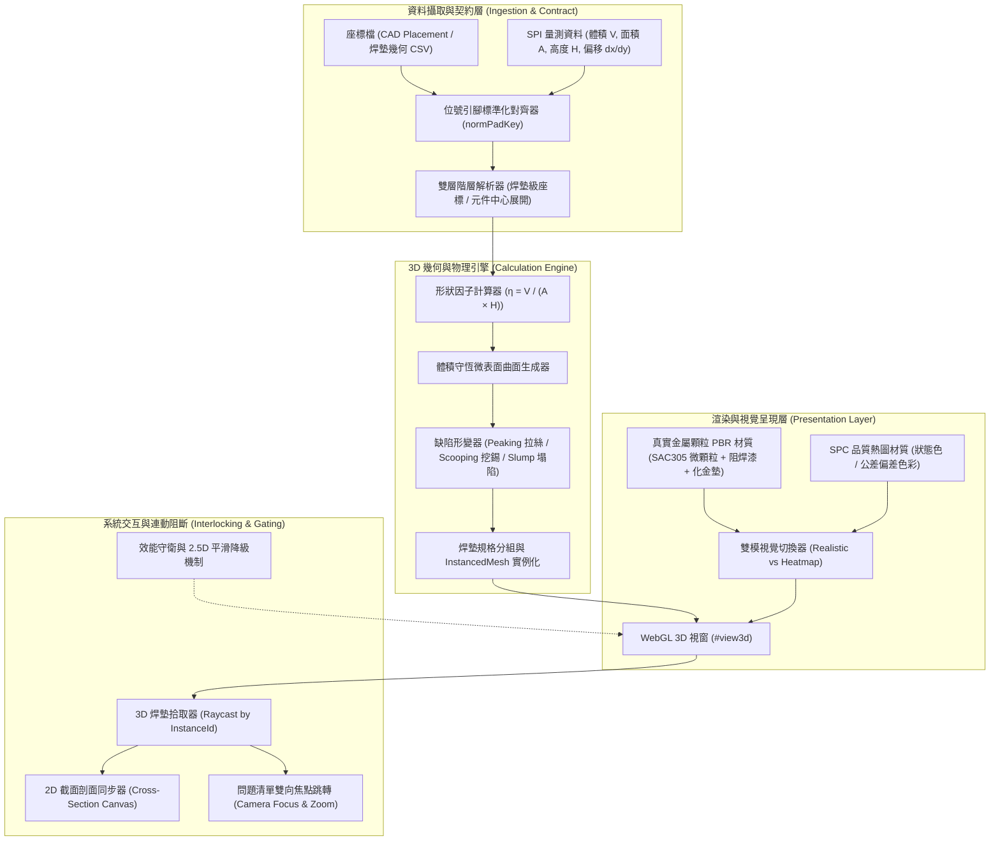

# RFC: 3D 錫膏模擬擬真化技術規格 (3D Solder Paste Realistic Simulation RFC)

- **狀態**：PROPOSED
- **日期**：2026-11-05
- **作者**：SPI·SPC 分析台架構組
- **對應任務**：讓 3D 錫膏模擬外觀與實際 PCBA 一致（微觀幾何物理化、體積守恆形狀重構、真實金屬顆粒 PBR 材質與雙模診斷切換）

---

## 1. 問題描述與目標 (Problem Statement & Goals)

### 1.1 背景與問題
現有 SPI·SPC 分析台之 3D 模擬（`#p-sim3d`）採用簡易幾何立方體與粗略參數拉伸（僅以面積放大長寬、高度直接決定 $Y$ 軸），存在以下與實際 PCBA 產線外觀脫節之關鍵瓶頸：
1. **外觀失真（缺乏金屬顆粒微觀質感）**：目前錫膏沉積物僅以單色平滑著色（綠色、紅色或彩虹偏差色），表面光滑如塑膠塊，無法還原 SAC305 無鉛錫膏由直徑 $20\sim 38\,\mu\text{m}$（Type 4）微球合金顆粒與助焊劑構成的霧面灰銀金屬質感。
2. **幾何體積未守恆（幾何形貌與量測體積脫節）**：實際印刷錫膏受鋼網開孔、脫模剪切、表面張力與重力塌陷影響，其截面形狀隨量測體積、面積與高度的比例（形狀因子 $\eta = V / (A \times H)$）呈現平頂梯形、圓拱穹頂或中心挖錫（Scooping）。現有網格未建立體積積分守恆，導致 3D 視覺厚薄與數值報表互相矛盾。
3. **底板與焊墊質感生硬**：PCB 板材基底僅為單一深綠色長方體，開窗焊墊缺乏真實化金（ENIG）或裸銅之金屬反射率與倒角，失去目檢儀器之真實對照感。
4. **萬筆焊墊效能隱憂**：整板高達 10,000 至 50,000 顆焊墊時，若逐顆建立獨立 `THREE.Mesh` 將引發 Draw Call 暴增與瀏覽器記憶體過載。

### 1.2 目標 (Goals)
1. **微觀金屬顆粒擬真度**：建立符合 SAC305 工業外觀的 PBR 材質（金屬灰銀色、微細金屬光澤、微顆粒噪點法線貼圖），並重現真實深綠阻焊漆基板與化金/裸銅開窗墊。
2. **體積守恆形狀因子幾何重構（Volume-Conserving Profile Reconstruction）**：
   依實測面積 $A$、高度 $H$ 與體積 $V$ 計算形狀因子 $\eta = V / (A \cdot H)$，動態解算微表面張力幾何曲面（含拉絲 Dog-ears、挖錫 Scooping、邊緣塌陷 Slump），保證網格數值積分體積與 SPI 量測體積嚴格一致。
3. **雙模視覺切換（Photorealistic vs Quality Heatmap）**：
   一鍵切換「真實外觀模式」（金屬顆粒錫膏＋銅箔墊）與「品質熱圖模式」（良率狀態色／高度體積偏差漸層色），兼顧產線目檢擬真與 SPC 製程工程診斷。
4. **雙向焦點聯動與流暢性**：
   點擊 3D 焊墊即時連動 2D 截面剖面、不良清單與側欄 HUD；從問題清單點擊「看證據」平滑聚焦該焊墊；以 `THREE.InstancedMesh` 批次渲染，在 20,000+ 焊墊下維持 60 FPS 與 <100MB 顯示記憶體開銷。

### 1.3 非目標 (Non-goals)
- 不在 SPI 階段強制加載貼片元件 3D 本體（晶片電阻、IC 塑料封裝等），因 SPI 是印刷後、貼片前的檢測環節。
- 不引入重型 WebGPU/PhysX 即時流體動力學模擬，避免低階電腦與行動裝置卡死；維持 WebGL/Three.js 輕量數值幾何演算法。
- 不修改 Cloudflare D1/R2 後端資料庫結構，維持無破壞性向下相容。

---

## 2. 系統架構 (System Architecture)

### 2.1 模組分層圖 (Mermaid Architecture)

---

## 3. 數學模型與計算不變性 (Mathematical Model & Invariants)

### 3.1 體積守恆形狀因子 (Volume-Conserving Shape Factor)
令開孔長寬為 $L_a, W_a$，有效底面尺寸為 $L_{\text{base}}, W_{\text{base}}$：
$$L_{\text{base}} = L_a \cdot \sqrt{\max\left(\frac{A_{\text{meas}}}{100}, 0.05\right)} + 2 \cdot \text{slump}$$
$$W_{\text{base}} = W_a \cdot \sqrt{\max\left(\frac{A_{\text{meas}}}{100}, 0.05\right)} + 2 \cdot \text{slump}$$
有效接觸面積 $A_{\text{base}} \approx L_{\text{base}} \cdot W_{\text{base}}$，峰值高度為 $H_{\text{peak}} = H_{\text{meas}} \cdot \text{exag}$。

定義無因次形狀因子（Shape Factor $\eta$）：
$$\eta = \frac{V_{\text{meas}}}{A_{\text{base}} \cdot H_{\text{meas}}}$$
其中：
- $\eta \approx 1.0$：柱狀/方塊（高度平坦分佈，如微型方孔網印初生狀）。
- $\eta \in [0.75, 0.90]$：典型平頂圓邊梯台（表面張力微倒角，標準良好印刷）。
- $\eta \in [0.55, 0.74]$：圓拱頂（穹頂化，常出現在細間距小錫膏或低塌陷潤濕）。
- $\eta < 0.55$ 或量測具備挖錫數據：中空下凹（中心 Scooping，助焊劑溢出或刮刀過度擠壓）。

### 3.2 微曲面高程函數 (Elevation Function $z(u, v)$)
在歸一化區域 $(u, v) \in [-1, 1] \times [-1, 1]$ 內，高程場以多項式徑向基底構造：
$$z(u, v) = H_{\text{peak}} \cdot \left[ 1 - c_{\text{edge}} \cdot (u^4 + v^4) \right] + h_{\text{peak\_dogear}}(u, v) - h_{\text{scoop}}(u, v)$$
透過數值權重 $\lambda$ 調節使：
$$\int_{-1}^{1} \int_{-1}^{1} z(u, v) \, du \, dv \equiv V_{\text{meas}}$$
嚴格維持體積積分不變性，絕不出現視覺體積與數據庫報表矛盾。

### 3.3 SAC305 微顆粒金屬 PBR 材質參數
- **基底色 (Albedo)**：`#9E9E98`（三元無鉛錫膏微球平均漫反射灰）。
- **金屬度 (Metalness)**：`0.70 ~ 0.75`（既非純鏡面金屬，亦非塑膠非金屬）。
- **粗糙度 (Roughness)**：`0.45 ~ 0.55`（助焊劑包覆下的微細顆粒漫散射）。
- **微觀法線貼圖 (Procedural Granular Normal Map)**：
  透過程式化 64×64 高頻白噪點生成擾動法線，模擬 Type 4 焊錫顆粒粒徑紋理。

---

## 4. 資料模型與介面契約 (Data Model & Contracts)

### 4.1 座標與量測資料對齊契約
1. **主鍵對齊**：以 `normPadKey(refdes, pin)`（如 `R1.1`、`U2.A1`）進行唯一映射。
2. **幾何降級梯隊**：
   - 第一優先：若資料提供 `padl, padw`（焊墊尺寸）及 `apl, apw`（鋼板開孔尺寸），採完全精確幾何。
   - 第二優先：若僅提供元件中心座標（`componentX, componentY`）與封裝（`pkg`），自動依封裝規格庫展開各 Pin 之精確局部偏移。
   - 保底處理：若完全無長寬資訊，以開孔預設值 $0.7\,\text{mm}$ 為基準並標註 `dimAssumed: true`。

### 4.2 UI 介面與控制項擴充
在 `#p-sim3d` 工具列新增：
- `#seg3dRenderMode`：
  - `[真實外觀]`（預設，PBR 金屬灰顆粒＋銅箔墊＋深綠板）。
  - `[品質熱圖]`（依當前狀態色、高度偏差或體積偏差著色）。
- `#chkSolderGrain`：顆粒紋理法線開關（低階裝置可自動關閉以省電）。

---

## 5. 行為驗收與相容性 (Acceptance & Compatibility)

| 使用情境／觸發 | 可觀察預期結果 | 例外／降級分支 | 應保留的既有行為 |
|---|---|---|---|
| 切換至「3D 錫膏模擬」分頁 | 錫膏呈現自然灰銀色金屬質感、板面深綠阻焊開窗可見銅金墊，曲面符合量測體積 | WebGL 不支援時顯示友好提示橫幅 | 保持下方 2D 板面比較圖與不良總覽正常運作 |
| 工具列切換「品質熱圖」 | 網格幾何保持真實微曲面不變，表面平滑過渡為紅/黃/綠判定色或偏差漸層 | 彩色模式切換延遲 < 50ms | 支援原本的高度、體積、判定狀態等色彩維度 |
| 點擊 3D 視圖中任一錫膏 | 該焊墊以發光外框突顯，側欄 2D 截面剖面即時同步繪出對應 X/Y 剖面曲線 | 點擊空白處取消選取 | 保持與原本 `pick(e)` 之資料結構相容 |
| 從不良問題清單點擊「看證據」 | SPA 自動切換至 3D 頁籤，相機平滑平移縮放聚焦至目標不良焊墊 | 目標焊墊無座標時提示「無空間座標，僅展示 2D」 | 保持 `go: {tab: "sim3d", board: b}` 呼叫契約 |
| 載入 20,000+ 焊墊大板 | 使用 `THREE.InstancedMesh` 批次繪製，頁面捲動與 3D 旋轉幀率維持 ≥ 55 FPS | 行動端 WebGL 記憶體受限時自動縮減細分頂點 | 保持與深色模式、多螢幕 Duo 模式相容 |

---

## 6. 架構取捨與風險備忘 (Trade-offs & Rollback)

1. **頂點密度 vs 幀率取捨**：
   單顆錫膏網格頂點設定為 $6 \times 6$ 網格（共 36 頂點、50 面），既能呈現圓拱、塌陷與邊緣倒角，又能保證整板 20,000 顆焊墊總面數在 100 萬面以內，搭配 GPU 實例化繪製無壓力。
2. **純 CPU 形狀因數解算 vs GPU 頂點著色器解算**：
   採用 CPU 預計算微曲面幾何參數並送入緩衝區，確保截面剖面（2D Canvas）能共用同一數學模型，計算結果完全一致。
3. **復原計畫 (Rollback Plan)**：
   保留既有 `createSolderPasteGeometry` 作為備用路徑，新邏輯封裝於 `reconstructSolderPasteMesh`，若使用者關閉進階擬真或硬體不支援，無縫回退至經典模式。
