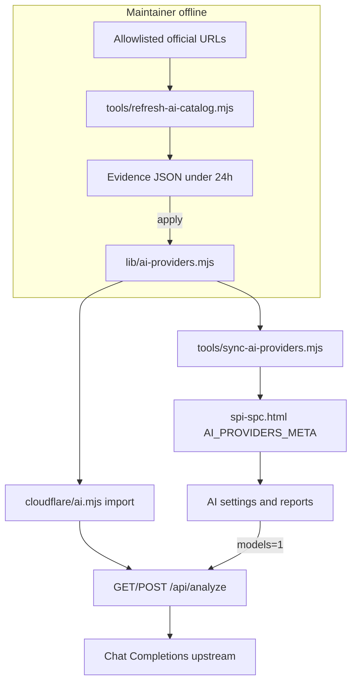

# RFC-SPI-AI-CATALOG-20261029：AI 推薦型錄汰舊與官方文件更新

**文件編號**：RFC-SPI-AI-CATALOG-20261029  
**狀態**：已實作（待合併／部署）。本規格不構成發布授權。  
**範圍**：推薦模型型錄、UI 標籤、依模型計價、維護用官方文件刷新命令；不含金鑰加密、帳本、全站配額駕駛艙（見 [spec-ai-provider-governance-rfc.md](./spec-ai-provider-governance-rfc.md)）。

**定案（2026-10-29）**：OpenAI **預設維持** `gpt-6.1-terra`；選單汰除已停用／不存在代碼，並加入現行官方推薦代碼；美金估算改為**依實際呼叫模型**計價；型錄正本收斂至 [`lib/ai-providers.mjs`](../lib/ai-providers.mjs)。

---

## 1. Summary

SPI·SPC 分析台的 AI 設定仍依寫死型錄與整個服務商一組單價估算用量，選單含已停用的 `o4-mini` 與不存在的 `gemini-3.0-flash`，介面又把 `gpt-6.1-terra` 標成「旗艦」。**操作者**（品質工程師／管理員）需要在不手改 repo 的前提下，看到與官方一致的推薦模型、正確的用量估算，並能由維護流程從官方文件產生可審查的更新提案。

成功條件：實作並通過本規格驗收後，三處型錄（正本、Worker、HTML meta）一致；推薦選單不含已證實停用或不存在的代碼；選用 `gpt-6-astra` 時每月美金累加使用 $10／$50（每百萬 tokens），而非 terra 的 $1／$5；刷新命令預設只輸出差異、不寫檔。

---

## 2. Scope

**In scope**

- 推薦型錄內容：各服務商 `defaultModel`、`models[]`、中文 UI 標籤（不含模型代碼括號內英文譯名以外的專名）。
- 正本單一化：`lib/ai-providers.mjs` → `cloudflare/ai.mjs` 匯入 → `tools/sync-ai-providers.mjs` 寫入 `spi-spc.html` `@ai-providers-meta`。
- 依**模型**的 `inputPricePerM`／`outputPricePerM`（及可選的價格有效區間），用於 `recordUsage` 與 UI 進度條估算。
- 已移除代碼的設定遷移（載入時改預設 + 狀態列說明）。
- 報告預覽／空狀態中寫死的模型名改為實際呼叫模型或泛化文案。
- 維護命令：自允許清單官方 URL 擷取 → 證據 JSON → 與正本 diff → 可選 `--apply` 寫入正本並跑 sync。
- 測試：型錄內容、計價、遷移、刷新夾具（不連網）。

**Out of scope**

- 不把 OpenAI 預設改為 `gpt-6-astra`；不提高預設每月 $5／每日 20 次上限。
- 不把 `gpt-6-luna`、影像／語音／Live／Embedding 模型列入推薦選單。
- 不改 Chat Completions 以外 API（Responses、Interactions、Antigravity 受管 agent `antigravity-preview-09-2026`）。
- 不恢復 Cursor 服務商。
- 不新增推理檔位 `xhigh`／`max`（仍 `high|medium|low`）。
- Worker 請求路徑上不執行官方網頁擷取。
- 本 RFC 不授權改版號、合併 main 或部署。

---

## 3. User Stories

- 作為**使用 AI 診斷的品質工程師**，我希望模型選單只列出仍被官方支援或專案驗證過的推薦代碼，以免選到必定 404 的項目。
- 作為**設定 API 的使用者**，我希望選較貴模型時，「本月預估費用」進度條反映該模型單價，以免誤以為還在 terra 費率下。
- 作為**維護者**，我希望執行刷新命令後看到附官方 URL 與擷取時間的差異報告，並在明確 `--apply` 前不修改 repo。
- 作為**讀取報告的審閱者**，我希望 AI 摘要標題顯示實際使用的模型，而非寫死的 `gpt-6.1-terra`。

---

## 4. Functional Requirements

### 4.1 型錄內容（核准時 baseline）

**OpenAI**（`chatUrl` 維持 `https://api.openai.com/v1/chat/completions`）

| 欄位 | 值 |
|---|---|
| `defaultModel` | `gpt-6.1-terra` |
| 推薦 `models`（順序） | `gpt-6.1-terra`、`gpt-6.1-sol`、`gpt-6-astra`、`gpt-5.4` |
| 移除 | `o4-mini`（官方狀態 Shut down，快照 2026-10-23） |
| UI 標籤角色 | terra＝推薦（**不得**再寫「旗艦深度推理」）；sol＝較高能力；astra＝旗艦；gpt-5.4＝較早世代、仍可用 |

**Antigravity**（`chatUrl` 維持 Google OpenAI 相容 Chat Completions）

| 欄位 | 值 |
|---|---|
| 目標 `defaultModel` | `gemini-3.8-flash` |
| 目標推薦 `models` | `gemini-3.8-flash`、`gemini-4-argon`、`gemini-3.1-pro-preview` |
| 移除 | `gemini-3.0-flash`（無此 API id；相近為 `gemini-3-flash-preview`）、`gpt-6.1-terra`（跨廠商，不屬 Gemini 型錄） |

- **FR-1.** `[ASSUMPTION]` `gemini-3.8-flash` 與 `gemini-4-argon` 可經現有 Antigravity 端點之 `/models` 或實際 Chat Completions 呼叫。實作 PR 合併前必須以**同一端點**之模型清單或整合測試證明；若未出現，**不得**改 Antigravity 預設，保留 `gemini-3.1-pro-preview` 為預設並在 CHANGELOG 標 `NOT VERIFIED`。
- **FR-2.** 各推薦項保留「自訂模型名稱…」選項；自訂字串仍符合 `/^[A-Za-z0-9._:/-]{2,120}$/`。
- **FR-3.** `cloudflare/ai.mjs` 的 `PROVIDERS` 改為自 `lib/ai-providers.mjs` 匯出；禁止再於 `ai.mjs` 內重複列出 `models` 陣列。

### 4.2 計價

- **FR-4.** 每個推薦模型（含自訂時 fallback 到該服務商預設模型費率）具 `inputPricePerM`、`outputPricePerM`（USD／百萬 tokens，與現行 `stats` 微美元累加一致）。
- **FR-5.** 下列為 **2026-10-29 官方頁** baseline；模型可帶 `pricingEffectiveUntil`（ISO 日期）與 `pricingNext`（下一檔費率）。刷新命令過期後必須提案更新，不得靜默沿用介紹價。

| 模型 | Input $/1M | Output $/1M | 漲價／備註 |
|---|---:|---:|---|
| `gpt-6.1-terra` | 1.00 | 5.00 | 穩定定價頁 |
| `gpt-6.1-sol` | 2.00 | 10.00 | 模型總覽 |
| `gpt-6-astra` | 10.00 | 50.00 | 模型總覽 |
| `gpt-5.4` | 2.50 | 15.00 | 模型頁 |
| `gemini-3.8-flash` | 0.75 | 3.75 | 有效至 **2026-12-31**；2027-01-01 起 1.50／7.50 |
| `gemini-4-argon` | 2.00 | 10.00 | 有效至 **2026-11-30**；2026-12-01 起 4.00／20.00 |
| `gemini-3.1-pro-preview` | 2.00 | 12.00 | `<200k` 上下文；官方 Gemini 3 定價表（preview） |

- **FR-6.** `recordUsage` 與 UI「本月預估美金」使用**實際呼叫模型 id** 對應費率，不再用整個 `PROVIDERS[provider].inputPricePerM` 單一值。

### 4.3 設定遷移與 UI 文案

- **FR-7.** `localStorage` `spi-ai-config` 中若 `model`／`customModel` 為已從型錄移除的代碼（含 `o4-mini`、`gemini-3.0-flash`、Cursor 相關），載入時改為該服務商 `defaultModel`，並在 `#aiCfgMsg`（或同等狀態列）顯示一次中文說明（含舊代碼與新預設）。
- **FR-8.** 報告 HTML 中 `AI 品質工程診斷摘要（…）` 使用本次分析實際模型 id；AI 頁空狀態／服務路徑說明不得寫死單一旗艦名稱（可寫「依設定模型」或動態插入目前選取模型）。
- **FR-9.** 「檢查可用模型」（`GET /api/analyze?models=1`）行為不變：仍只查上游，不寫型錄；停用推薦項後，使用者自訂輸入 `o4-mini` 仍得現行 404 文案（含「檢查可用模型」指引）。

### 4.4 官方文件刷新命令

- **FR-10.** 新增維護腳本（建議 `tools/refresh-ai-catalog.mjs`，名稱實作時可調整但須在 CHANGELOG 記載）：預設 **dry-run**，stdout 輸出 JSON 或結構化文字 diff。
- **FR-11.** 允許擷取的 URL 網域（HTTPS only）：
  - OpenAI：`developers.openai.com`、`platform.openai.com` — 路徑含 `/api/docs/models`、各模型 `.md`、`/api/docs/deprecations`
  - Google：`ai.google.dev` — `/gemini-api/docs/models`、`/gemini-api/docs/deprecations`、`/gemini-api/docs/pricing` 及模型專頁
- **FR-12.** 每次執行寫入證據檔（建議 `tools/.ai-catalog-evidence/<UTC-date>.json`），每筆含：`url`、`fetchedAtUtc`、`contentSha256`、`extractedModelIds`、`status`（如 `current|legacy|shut_down|preview`）、`pricing`（若有）、`success`。證據 **`fetchedAtUtc` 距今 >24h** 時，`--apply` **必須拒絕**並 exit 非 0。
- **FR-13.** `--apply` 僅在：證據有效、diff 非空、且維護者顯式傳旗標時，更新 `lib/ai-providers.mjs` 並依序執行 `node tools/sync-ai-providers.mjs`；不得自動 commit。
- **FR-14.** 單元測試使用固定 HTML/Markdown 夾具（repo 內 `tests/fixtures/ai-catalog/`）；夾具中 `o4-mini` 標 Shut down 時，刷新邏輯提案**必須**含「自 OpenAI 推薦列表移除 `o4-mini`」；未 `--apply` 時正本 byte 不變。

### 4.5 與治理 RFC 的銜接

- **FR-15.** 實作 [spec-ai-provider-governance-rfc.md](./spec-ai-provider-governance-rfc.md) 時，`ai_provider_settings.selected_model` 的合法值以**正本型錄 + custom** 為準；本 RFC 先落地型錄正本與計價，治理 migration 可後續合併，但不得再引用「型錄僅在 `cloudflare/ai.mjs`」— 應改為「型錄以 `lib/ai-providers.mjs` 為準，`ai.mjs` 匯入」。

---

## 5. Acceptance Criteria

### FR-1 / FR-2（OpenAI 選單）

- **Given** build 產物已載入 AI 設定且服務商為 OpenAI  
  **When** 使用者開啟 `#selAiModel`  
  **Then** 選項含 `gpt-6.1-terra`、`gpt-6.1-sol`、`gpt-6-astra`、`gpt-5.4` 與「自訂模型名稱…」，且**不含** `o4-mini`。

- **Given** 同上  
  **When** 檢視 terra 的顯示標籤  
  **Then** 標籤含「推薦」語意且**不含**「旗艦深度推理」字樣。

### FR-1 / FR-2（Antigravity 選單）

- **Given** Antigravity 端點模型清單已驗證含 `gemini-3.8-flash`  
  **When** 使用者開啟模型選單  
  **Then** 預設選取為 `gemini-3.8-flash`，且**不含** `gemini-3.0-flash` 與 `gpt-6.1-terra`。

- **Given** 端點清單**未**含 `gemini-3.8-flash`（測試以 mock 模擬）  
  **When** 部署該 build  
  **Then** 預設仍為 `gemini-3.1-pro-preview`，且文件／CHANGELOG 註記驗證未完成。

### FR-4 / FR-6（計價）

- **Given** 使用者選 `gpt-6-astra` 且完成一次分析，`usage` 回傳 input 1M、output 0  
  **When** 讀取 D1 `stats` 微美元累加或 UI 本月美金  
  **Then** 增量對應 $10.00 輸入費率（±四捨五入與現行 `ucost` 算法一致），**不是** $1.00。

- **Given** 使用者選 `gpt-6.1-terra`  
  **When** 同上  
  **Then** 仍為 $1.00／$5.00 費率。

### FR-7（遷移）

- **Given** `localStorage` 中 OpenAI `model` 為 `o4-mini`  
  **When** 重新載入頁面並進入 AI 設定  
  **Then** 模型改為 `gpt-6.1-terra` 且狀態列出現一次性遷移說明。

### FR-10 / FR-13（刷新命令）

- **Given** 正本與夾具證據一致  
  **When** 執行刷新命令**不帶** `--apply`  
  **Then** `lib/ai-providers.mjs` 與 `spi-spc.html` meta **無**變更。

- **Given** 夾具證據標記 `o4-mini` shut down 且正本仍含 `o4-mini`  
  **When** dry-run  
  **Then** 輸出提案含移除 `o4-mini`。

- **Given** 證據檔 `fetchedAtUtc` 超過 24 小時  
  **When** 執行 `--apply`  
  **Then** 命令失敗且不寫檔。

### FR-3（正本一致）

- **Given** 已修改 `lib/ai-providers.mjs` 並執行 sync  
  **When** `grep` 或測試比對 `cloudflare/ai.mjs` 與 `@ai-providers-meta`  
  **Then** 各 provider 的 `models` 與 `defaultModel` 與正本一致。

### FR-8（報告標題）

- **Given** 使用者以 `gpt-6.1-sol` 完成 AI 分析並開啟報告預覽  
  **When** 檢視 AI 摘要標題  
  **Then** 標題含 `gpt-6.1-sol` 或不含寫死的 `gpt-6.1-terra` 專名。

---

## 6. Edge Cases and Failure Modes

- **Case：** 官方頁面 403／timeout。**Behavior：** 該 URL 在證據中 `success: false`；刷新不提案刪除仍為執行中預設的模型；dry-run 以非 0 exit 或警告區塊列出失敗 URL。
- **Case：** OpenAI 與 Google 頁面對同一 id 狀態矛盾。**Behavior：** 該 id 標 `not_verified`，不自動從型錄移除現行預設。
- **Case：** 使用者自訂模型名不在型錄。**Behavior：** 計價 fallback 到該服務商 `defaultModel` 費率，並在 UI 計價 chip 標示「估算依預設模型費率」[`ASSUMPTION`]。
- **Case：** Antigravity 預設改為 `gemini-3.8-flash` 後舊紀錄報告仍顯示舊模型。**Behavior：** 僅影響新分析；歷史 `S.ai` 不重寫。
- **Case：** 價格已過 `pricingEffectiveUntil` 但尚未跑刷新。**Behavior：** 實作可選：runtime 使用 `pricingNext` 若日期已過（須測試）；否則在 AGENTS 或 CHANGELOG 要求每月跑刷新—本 RFC **至少**要求 `--apply` 路徑更新過期價。
- **Case：** `npm test` 在 Windows CRLF。**Behavior：** 型錄／刷新測試斷言使用 `\r?\n`（見 AGENTS.md）。

---

## 7. Non-Functional Requirements

- **Performance：** 刷新命令單次擷取 ≤10 個 URL，總 wall time 本機 **<60s**（不含網路時用夾具 **<3s**）；不增加 `/api/analyze` POST 延遲。
- **Security：** 刷新僅 outbound HTTPS 至允許網域；證據檔不得含 API Key；`.ai-catalog-evidence/` 若含在 repo 則僅夾具摘要，不提交 live 擷取含機密 query。
- **Compatibility：** 維持 Chat Completions + 現行 `X-AI-*` 標頭行為（至治理 RFC 忽略標頭前）；Chrome／Safari 最新兩版 + 320px 寬度下 AI 設定卡不橫向溢出（沿用 `mobile-layout` 8b）。
- **Observability：** 刷新 dry-run 輸出 diff 行數與證據 sha；Worker 不在 catalog 變更時打 log PII。

---

## 8. System Architecture



**執行期資料流（計價）**

1. 解析實際 `model` id（headers 或 D1 設定，現行為 headers；治理後為伺服器設定）。
2. `lookupModelPricing(provider, modelId)` → `{ inputPricePerM, outputPricePerM }`。
3. `recordUsage` 用該費率寫入 `ucost`；GET 摘要之 `usage.monthlyUsd` 與 UI 進度條一致。

---

## 9. Data Model and Interfaces

### 9.1 正本結構（`AI_PROVIDER_CATALOG[]`）

每 provider 物件至少：

```text
id, label, chatUrl, defaultModel,
models: string[],           // 推薦 API id，不含 "custom"
modelUi: Record<modelId, string>,  // 中文標籤
modelPricing: Record<modelId, {
  inputPricePerM: number,
  outputPricePerM: number,
  pricingEffectiveUntil?: string,  // YYYY-MM-DD
  pricingNext?: { inputPricePerM, outputPricePerM }
}>,
headerKey, ui: { priceText?, ... }  // priceText 改為「依模型計價」或顯示預設模型費率
```

匯出 `PROVIDERS`（供 Worker）時含扁平 `models` + 預設費率欄位（deprecated，僅 fallback）。

### 9.2 證據 JSON（片段）

```json
{
  "schemaVersion": 1,
  "generatedAtUtc": "2026-10-29T10:00:00Z",
  "sources": [
    {
      "url": "https://developers.openai.com/api/docs/models/o4-mini.md",
      "fetchedAtUtc": "2026-10-29T10:00:00Z",
      "contentSha256": "…",
      "success": true,
      "extracted": { "modelId": "o4-mini", "status": "shut_down" }
    }
  ]
}
```

### 9.3 測試契約

- 擴充 [`tests/ai-model.test.mjs`](../tests/ai-model.test.mjs)：型錄不含 `o4-mini`／`gemini-3.0-flash`；Astra 計價 case。
- 新增 `tests/ai-catalog-refresh.test.mjs`（或併入 ai-model）：夾具驅動刷新邏輯。
- [`tests/step14.test.mjs`](../tests/step14.test.mjs) 預設 terra 斷言保留；移除對已刪型錄項之正向斷言。

---

## 10. Baseline Official Evidence（2026-10-29）

實作 PR 應在描述中鏈結下列頁面；刷新命令應能重新擷取同等資訊。

| 主題 | URL |
|---|---|
| OpenAI 模型總覽 | https://developers.openai.com/api/docs/models |
| OpenAI 最新模型指南 | https://developers.openai.com/api/docs/guides/latest-model |
| o4-mini（Shut down） | https://developers.openai.com/api/docs/models/o4-mini |
| gpt-6.1-terra | https://developers.openai.com/api/docs/models/gpt-6.1-terra |
| gpt-5.4 | https://developers.openai.com/api/docs/models/gpt-5.4 |
| OpenAI deprecations | https://developers.openai.com/api/docs/deprecations |
| Gemini 模型 | https://ai.google.dev/gemini-api/docs/models |
| Gemini deprecations | https://ai.google.dev/gemini-api/docs/deprecations |
| Gemini pricing | https://ai.google.dev/gemini-api/docs/pricing |
| Gemini 3.8 Flash 說明 | https://ai.google.dev/gemini-api/docs/generate-content/whats-new-gemini-3.8 |
| Gemini 4 Argon 說明 | https://ai.google.dev/gemini-api/docs/generate-content/latest-model |

---

## 11. Dependencies

- Node ≥ 與 repo 現行 `package.json` engines 一致；刷新腳本僅用 Node 內建 `fetch`（Node 18+）或既有依賴。
- `tools/sync-ai-providers.mjs` 與 `spi-spc.html` `@ai-providers-meta` 標記（已存在）。
- 可選：後續治理 RFC `0008` 不阻塞本 RFC，但 D1 持久化模型時須讀正本。

---

## 12. Risks and Mitigations

| 風險 | 緩解 |
|---|---|
| Gemini 新 id 在 OpenAI 相容端點不可用 | FR-1 閘門：/models 或整合測試通過才改預設 |
| Astra 費率約 terra 10×，$5 月上限更快觸頂 | 預期行為；規格不提高上限；UI 可選加「高費率模型」提示 [`OPEN_QUESTION`] |
| 介紹價 2026-11-30／2027-01-01 變動 | 證據 + `pricingEffectiveUntil`；刷新拒絕過期 apply |
| 未追蹤 `lib/ai-providers.mjs` 與線上不一致 | 實作以 `cloudflare/ai.mjs` 現行內容 merge 進正本後刪 stale Cursor／mini |
| 官方頁面結構變更導致解析失敗 | 解析器 fail-visible；不 silent 刪模型 |

---

## 13. Open Questions

- **[OPEN_QUESTION]** 自訂模型計價 fallback 是否要在 UI 常駐提示，或僅在 admin 說明？
- **[OPEN_QUESTION]** 證據 JSON 是否進 git（建議 `.gitignore` live 擷取，只提交 `tests/fixtures`）。
- **[OPEN_QUESTION]** Antigravity 若僅部分帳號可見 `gemini-4-argon`，推薦列表是否仍顯示但「檢查可用模型」停用—建議維持顯示 + 上游停用 pattern 與 v10.10.0 一致。

---

## 14. Success Metrics

- **Leading：** 合併後 `npm test` 含新型錄／刷新測試全綠；dry-run 刷新在 CI 可選 job（allow failure）產 diff artifact。
- **Lagging：** 上線 30 日內無因選單含 `o4-mini`／`gemini-3.0-flash` 的支援工單；`model_not_found` 率相對前 30 日下降（若已有 log 維度）。

---

## 15. Test Plan（實作 PR）

- [ ] `node --test tests/ai-model.test.mjs tests/ai-catalog-refresh.test.mjs`（新增）
- [ ] `npm test`（Windows 本機）
- [ ] `npm run build:cloudflare` 後 build 產物：AI 設定 OpenAI／Antigravity 選單、報告 AI 標題
- [ ] Antigravity：對正式或 staging 金鑰執行「檢查可用模型」，確認 `gemini-3.8-flash` 在清單（若無則依 FR-1 保留舊預設並記錄）
- [ ] 320px 明亮／深色 AI 設定卡無橫向溢出

---

## 16. Definition of Done（本 RFC 文件）

- [x] 問題、操作者、成功條件已寫明
- [x] In／Out scope 已列
- [x] FR 編號可對應 Given／When／Then
- [x] 官方 baseline URL 與漲價日已記錄
- [x] 與治理 RFC 邊界已說明

**Definition of Done（實作）**：上述 Test Plan 全勾；CHANGELOG 與 AGENTS 型錄來源句更新；未授權不 bump 版本／不部署。
