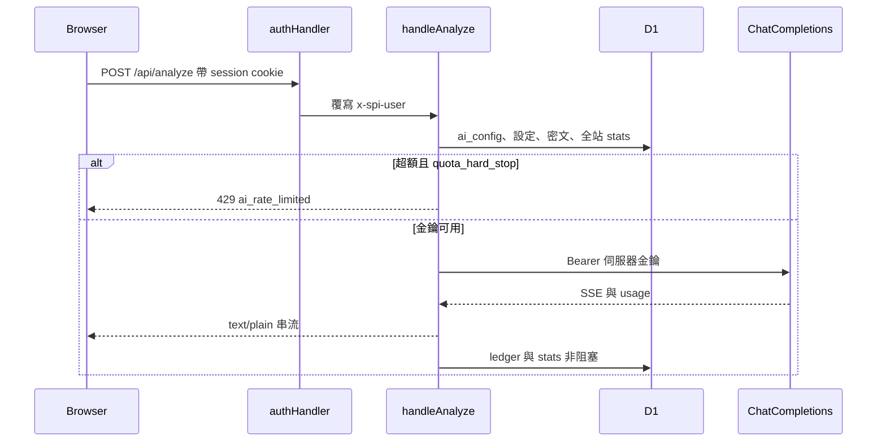

# RFC-SPI-AI-GOV-20261029：AI 供應商治理

狀態：待核准實作。本規格不構成發布授權。

定案（2026-10-29）：**全站各服務商一組金鑰，只有 `admin_roles` 管理員能寫入；一般使用者只做診斷、看自己的用量。配額與硬阻斷由管理員設定，以全站合計為準。**

對齊治理技能：`integrate-ai-provider` 六大維度（金鑰零洩漏、動態型錄、推理參數、用量帳本、配額硬阻斷、管理駕駛艙 UI）。

---

## 1. 背景（已查證的事實）

- **金鑰在瀏覽器。** `#p-ai` 設定面板（`spi-ai-config` / `localStorage`）存放 OpenAI、Antigravity、Cursor 三組 API Key，經 `X-OpenAI-Key`、`X-Antigravity-Key`、`X-Cursor-Key` 送到 `cloudflare/ai.mjs` 的 `resolveApiKey`。v10.6.0–v10.8.0 CHANGELOG 寫明金鑰不落入 D1。
- **任何登入者可改配額。** `PUT /api/analyze` 把每人每日次數、每月 token、每月美金上限寫入 `system_settings`（鍵 `ai_limits:{user}` 或 `ai_limits:{provider}:{user}`）。`sanitizeLimits` 上限為 500 次／日、1,000 萬 token、$500。`X-AI-Limits` 請求標頭只能再收緊，不能放寬。
- **用量無逐次帳本。** 計數在 D1 `stats`（每人、每服務商、UTC+8 日／月鍵），沒有模型、延遲、成敗代碼的審計列。
- **模型與推理由客戶端標頭決定。** `resolveModelAndEffort` 讀 `X-AI-Model`、`X-AI-Reasoning-Effort`（及 OpenAI 的 `env.AI_MODEL`）。伺服器沒有持久化的型錄設定列。
- **三平台皆 Chat Completions 相容。** `OPENAI_CHAT_URL`、`ANTIGRAVITY_CHAT_URL`、`CURSOR_CHAT_URL`；未使用 Gemini 原生 SDK 或 `thinkingBudget`。
- **身份與管理員。** `lib/auth-handler.mjs` 驗證 session 後對 `/api/*` 設定 `x-spi-user`。`Repo.isAdmin` 查 `admin_roles`（0007 migration），與 `/api/admin/users` 相同。

## 2. 目標與非目標

**目標**

1. 管理員設定的 API Key 以 AES-256-GCM 存 D1；API 回應、前端渲染、日誌不出現明文 Key、密文或 nonce。
2. 啟用服務商、模型、推理強度、最大輸出、自訂端點由伺服器設定決定；客戶端標頭不能改模型、金鑰、端點或放寬配額。
3. 每次診斷與連線測試非阻塞寫入 `ai_usage_ledger`。
4. 全站每日請求、每月 token、每月美金達管理員上限且 `quota_hard_stop=1` 時，呼叫上游前回 `429`、`code=ai_rate_limited`；停用「產生分析報告」；統計、管制圖、報告等其他分頁不受影響。
5. AI 頁改為治理駕駛艙：三張指標卡、分頁（服務商／配額／日誌）；管理員可寫，其他人唯讀；沿用 `toast()` 與既有 Modal 模式（`role="dialog"`、`aria-modal`、Esc、焦點歸還），禁用 `alert()`／`confirm()`。

**非目標**

- 不改 `validatePayload`、`buildMessages`、`SYSTEM_PROMPT`、串流正文格式；不新增第二套手動填寫診斷表單。超額降級＝停用 AI 按鈕。
- 不接 Gemini 原生 SDK；不做 `thinkingBudget` 數字滑桿。推理強度僅在既有 `high|medium|low` 上加 `off`（不送 `reasoning_effort`）。
- `temperature` 可存 D1（預設 0.1），本版不送進上游 JSON（現況未送，避免推理模型拒收）。
- 不做每人 BYOK；不做每人獨立配額數字（全站上限為準，個人鍵僅供「我的用量」顯示）。
- 不做獨立純白 React 頁；駕駛艙用既有 CSS token（`--surface`、`--ink`、`--line`），明亮為預設，深色主題沿用專案對比規則。技能文件中的 Slate  mock 只取資訊架構。
- 本 RFC 不授權改版號或部署。實作 migration 檔名 **`0008_ai_governance.sql`**；合併前依 `AGENTS.md` 對遠端執行 `npx wrangler d1 migrations list spi-spc --remote`，未套用時備份（repo 外）、演練、核准後再合併。

## 3. 架構與資料流



### 3.1 金鑰解析順序

1. 該 `provider` 在 `ai_credentials` 有列且 `AI_CREDENTIAL_MASTER_KEY` 可解密 → **只用**解密結果。
2. 有密文但主金鑰缺失或解密失敗 → 分析 **`503`**（不 fallback 到環境變數，避免計費帳號不一致）。
3. 無密文列 → 沿用 `OPENAI_API_KEY`／`ANTIGRAVITY_API_KEY`／`GEMINI_API_KEY`／`CURSOR_API_KEY`（與現行 `getServerEnvKey` 一致）。

`AI_CREDENTIAL_MASTER_KEY`：Worker secret，32-byte Base64。管理員儲存金鑰時若缺失 → **`503`**、`code=ai_master_key_missing`。無 D1 密文時分析仍可走環境變數。

### 3.2 Migration 未套用（安全降級）

- 登入與其他 API **不得**因新表缺失而 500。
- `hasExtendedSchema()` 探針失敗時：分析退回「環境變數金鑰 + 既有每人 `stats`／`system_settings` 配額」；`GET /api/analyze` 回 `schemaReady: false`。
- 管理員 `PUT` 在新表不存在時 → **`503`**、`code=ai_schema_missing`。

### 3.3 其他守衛

- 自訂端點：僅讀 `ai_provider_settings.endpoint`；忽略 `X-AI-Endpoint`。仍用現有 `validateEndpointUrl`（https、擋 localhost／私網／URL 帳密）。
- `AI_ENABLED=false` → 整條分析 **`403`**（維持現行）。

## 4. 資料模型

新檔：`cloudflare/migrations/0008_ai_governance.sql`（實作時）。**不改**既有表欄位。

### 4.1 `ai_credentials`

| 欄位 | 說明 |
|---|---|
| `provider` | PK：`openai` \| `antigravity` \| `cursor` |
| `ciphertext` | AES-256-GCM 密文（Base64） |
| `nonce` | 12-byte IV（Base64），每次加密必換 |
| `updated_at` | ISO-8601 |
| `updated_by` | 管理員 `x-spi-user` |

加密：Web Crypto AES-GCM；主金鑰直接作 raw key（不做 PBKDF2）。Base64 編解碼分塊，避免大陣列 spread。

### 4.2 `ai_config`（單列 `id=1`）

| 欄位 | 說明 |
|---|---|
| `active_provider` | 目前啟用之服務商 |
| `updated_at` | ISO-8601 |

### 4.3 `ai_provider_settings`（每 provider 一列）

| 欄位 | 預設 | 說明 |
|---|---|---|
| `selected_model` | 見 `PROVIDERS` | 推薦型錄代碼 |
| `custom_model` | `''` | 自訂模型名；非空時覆寫 `selected_model` |
| `reasoning_effort` | `high` | `off` \| `low` \| `medium` \| `high` |
| `max_output_tokens` | **16000** | 對應現行 `MAX_TOKENS` |
| `temperature` | 0.1 | 儲存用；本版不送 upstream |
| `endpoint` | `''` | 空＝官方 `chatUrl` |
| `updated_at` | | ISO-8601 |

型錄來源：以 [`lib/ai-providers.mjs`](../lib/ai-providers.mjs) 為準，`cloudflare/ai.mjs` 匯入；自訂模型沿用 `/^[A-Za-z0-9._:/-]{2,120}$/`。維護刷新見 [`tools/refresh-ai-catalog.mjs`](../tools/refresh-ai-catalog.mjs) 與 [spec-ai-model-catalog-rfc.md](./spec-ai-model-catalog-rfc.md)。

### 4.4 `ai_quota_config`（單列 `id=1`，**全站**）

| 欄位 | 預設 | 說明 |
|---|---|---|
| `daily_request_limit` | 20 | 0＝不限制（實作時若允許 0 需與技能一致；預設列用 20） |
| `monthly_token_budget` | 500000 | 輸入+輸出 token 合計 |
| `monthly_usd_limit` | 5.0 | 第三道上限（保留 v10.8） |
| `quota_hard_stop` | 1 | 1＝超額攔截；0＝僅警示，`GET` 帶 `quotaWarning` |
| `updated_at` | | ISO-8601 |

硬阻斷讀 **全站** `stats` 鍵，不再以每人 `system_settings` 的 `ai_limits:*` 為上限來源（個人鍵保留供「我的用量」）。

全站鍵（UTC+8 日／月，與現行 `utc8Periods` 一致）：

- `ai:org:d:{day}:req`
- `ai:org:m:{month}:req`
- `ai:org:m:{month}:in_tok`
- `ai:org:m:{month}:out_tok`
- `ai:org:m:{month}:ucost`（微美元累加，與現行 `recordUsage` 一致）

每人鍵：保留現行 `providerStorageKeys` 前綴（`ai:` / `ai:{provider}:`），供 UI「我的今日／本月」。

**計數語意**

- 每日請求：在 **fetch 上游之前** +1（含上游 HTTP 錯誤），防重試繞過。
- Token／美金：僅在取得 usage（或估算 fallback）後累加。
- `quota_hard_stop=0`：超額仍呼叫 upstream。

### 4.5 `ai_usage_ledger`

| 欄位 | 說明 |
|---|---|
| `id` | UUID |
| `actor_id` | 發起者（session user） |
| `provider` | |
| `model` | 實際呼叫模型 |
| `call_type` | `analyze` \| `test` |
| `prompt_tokens` / `completion_tokens` / `total_tokens` | |
| `latency_ms` | |
| `success` | 1/0 |
| `failure_code` | 如 `ai_rate_limited`、`ai_error` |
| `created_at` | ISO-8601 |

索引：`created_at`；`(actor_id, call_type)`。寫入包在 try/catch，失敗只 `console.warn`。

**保留**：既有 Worker cron 擴充——每次最多刪 200 列、`created_at` 早於 180 天。

## 5. API 契約

皆需已登入；**身份僅** session 覆寫後的 `x-spi-user`（忽略客戶端自填 user）。

### 5.1 `GET /api/analyze`

**誰**：任何登入者。

**回應**（示意；不得含 Key／密文／nonce）：

```json
{
  "ok": true,
  "schemaReady": true,
  "isAdmin": false,
  "activeProvider": "openai",
  "model": "gpt-6.1-terra",
  "reasoningEffort": "high",
  "configured": true,
  "providers": { "openai": { "label": "OpenAI", "hasKey": true, "models": ["..."] } },
  "quota": { "dailyRequestLimit": 20, "monthlyTokenBudget": 500000, "monthlyUsdLimit": 5, "quotaHardStop": true },
  "orgUsage": { "day": "2026-10-29", "dailyRequests": 3, "monthlyTotalTokens": 12000, "monthlyUsd": 0.05 },
  "mine": { "dailyRequests": 1, "monthlyTotalTokens": 4000 },
  "quotaWarning": null
}
```

`configured`：啟用服務商至少有一條可用金鑰路徑（D1 解密或 env fallback）。

### 5.2 `PUT /api/analyze`

**誰**：`Repo.isAdmin`；否則 **`403`**。

**Body**（部分更新）：

- `activeProvider`
- `providers.{id}`：`apiKey`（有值才重加密）、`clearKey: true`（刪密文；空字串**不是**清除）、`selectedModel`、`customModel`、`reasoningEffort`、`maxOutputTokens`、`endpoint`
- `quota`：`dailyRequestLimit`、`monthlyTokenBudget`、`monthlyUsdLimit`、`quotaHardStop`

成功回更新後的 `GET` 同等摘要（仍無 Secret）。

### 5.3 `GET /api/ai/ledger`

**路由**：實作時在 `worker.mjs` 新增（或併入 analyze handler 之子路徑，文件以 **`GET /api/ai/ledger`** 為準）。

**誰**：管理員可列全站；非管理員自動 `WHERE actor_id = ?`。

**Query**：`limit`≤50，`before` keyset（`created_at,id`）。

### 5.4 `POST /api/analyze`

**行為變更**：

- **忽略** `X-OpenAI-Key`、`X-Antigravity-Key`、`X-Cursor-Key`、`X-AI-Model`、`X-AI-Reasoning-Effort`、`X-AI-Endpoint`、`X-AI-Limits`。
- 無可用金鑰 → **`400`**（沿用使用者可讀文案）。
- 超額且 hard stop → **`429`**：

```json
{
  "success": false,
  "code": "ai_rate_limited",
  "error": "已達今日 AI 請求上限…",
  "fallback_to_manual": true,
  "orgUsage": { },
  "quota": { }
}
```

（現行 `daily_limit_exceeded` 等 code 合併為對外 **`ai_rate_limited`** 或保留細分 code 並保證含 `fallback_to_manual: true`——實作時擇一並更新測試。）

**連線測試**：`call_type=test`、極短 user message；同配額；僅管理員 UI，確認 Modal 後才 POST。

**串流成功**：仍 `text/plain`；回應標頭可保留 `X-AI-Provider`、`X-AI-Model`、`X-AI-Reasoning-Effort`、`X-AI-Usage`（用量為全站／個人摘要 JSON，無 Key）。

## 6. 前端（`spi-spc.html` `#p-ai`）

### 6.1 資訊架構

- **頂部三卡**：① 啟用引擎（狀態燈＋服務商名）② 全站今日請求（進度條）③ 全站本月 token（進度條；美金額度寫在同一卡文字，超額不只靠顏色）。
- **分頁**：服務商與模型｜用量配額｜調用日誌。
- **管理員**：金鑰輸入（password）、儲存、清除（Modal 確認）、連線測試（Modal 確認）、配額編輯。
- **非管理員**：隱藏金鑰欄與儲存；顯示「我的」次數／token；診斷按鈕依 `configured` 與 `429` 狀態啟用。

### 6.2 `localStorage` 遷移

- 管理員：可選一次「將本機金鑰存入伺服器並清除本機」（呼叫 `PUT` 後刪 `spi-ai-config` 內 `apiKey` 欄）。
- 非管理員：進入 AI 頁時清除本機金鑰欄位，**不**代為上傳。

### 6.3 版面與 a11y

- Grid：`minmax(0,1fr)`；觸控 ≥44px；`select` `max-width:100%`。
- 日誌：桌面表格式；`max-width:720px` 卡片流；表單控制項字級 ≥16px。
- 通知：`toast()`；破壞性／付費操作：既有 Modal 焦點陷阱。

## 7. 安全、測試與上線

### 7.1 威脅與控制

| 風險 | 控制 |
|---|---|
| 客戶端換 Key／抬高配額 | POST/PUT 忽略 Key 標頭；配額僅管理員 PUT |
| Key 洩漏 via API/HTML | 不回明文／密文；ledger 不存 prompt/response |
| SSRF 自訂端點 | 沿用 `validateEndpointUrl` |
| 管理員濫用 | `admin_roles` + audit（可選：ledger `actor_id` 已足夠追溯） |

`AI_LOG_PAYLOAD` 預設 `false`（維持 `cf-aig-collect-log-payload: false` 行為）。

### 7.2 測試（實作時更新 `tests/ai-model.test.mjs` 等）

- 客戶端 Key 標頭不出現在 upstream `Authorization`。
- 非管理員 `PUT` → 403。
- `GET` JSON 不含 `sk-`、密文樣式欄位。
- 硬阻斷在 mock `fetch` 之前觸發。
- ledger insert 拋錯時串流仍 200 完成。
- 自訂 endpoint 仍拒絕 `http://127.0.0.1`。
- schema 未就緒：GET `schemaReady:false`、管理員 PUT 503。

### 7.3 部署與回滾

- 合併前：遠端 migration 清單、`npm test`、`npm run release-check`。
- 部署驗證：登入後 `GET /api/analyze` 200 且 `schemaReady` 符合預期；至少一筆 `POST` 或管理員設定路徑（依環境 Key 與 master secret 而定）。
- 回滾：舊 Worker 忽略新表；保留 env Key 直到 D1 金鑰驗證完成。主金鑰輪替不在本 RFC。

## 8. 六大治理維度對照

| 維度 | 本 RFC |
|---|---|
| 1 金鑰零洩漏 | D1 AES-GCM + `AI_CREDENTIAL_MASTER_KEY`；前端無 Key |
| 2 動態型錄 | `ai_provider_settings` + `PROVIDERS` 推薦清單／自訂模型 |
| 3 推理參數 | `reasoning_effort` 含 `off`；`max_output_tokens`；temperature 存不送 |
| 4 用量帳本 | `ai_usage_ledger` 非阻塞 |
| 5 配額硬阻斷 | `ai_quota_config` 全站 + `ai_rate_limited` |
| 6 管理駕駛艙 | 三卡 + 分頁；admin 寫／user 讀；toast + Modal |

---

## 9. 實作清單（核准後）

1. `0008_ai_governance.sql` + `lib/ai-crypto.mjs`（或等價模組）
2. 重構 `cloudflare/ai.mjs`：`handleAnalyze`、ledger、org quota、`GET /api/ai/ledger`
3. `cloudflare/worker.mjs` 路由 `/api/ai/ledger`
4. `spi-spc.html` 駕駛艙 UI + 移除 BYOK 送出路徑
5. 測試與 CHANGELOG（實作 PR 內；不在本文件階段）

**本文件階段**：僅規格；程式碼變更待核准後另 PR。
