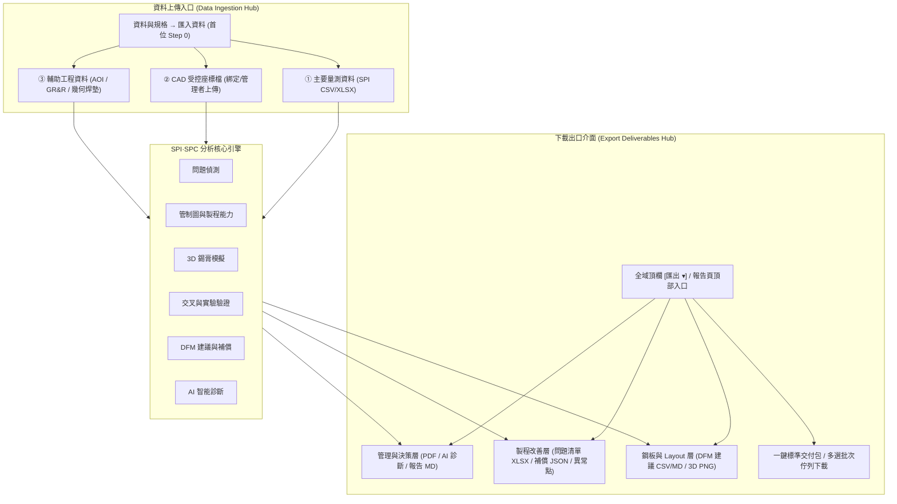

# RFC-SPI-UI-ENTRY-EXIT-20261109：分析台資料上傳入口與下載出口整合介面規格書

**文件編號**：RFC-SPI-UI-ENTRY-EXIT-20261109  
**版本**：v1.0 (依 Clarify-Before-Execute 6 階相依審定決策起草)  
**日期**：2026-11-09  
**狀態**：提議中 (Pending Approval)  
**作者**：Antigravity Agent  
**審查對象**：前端工程師、SMT 製程工程師、SPC 分析員、QA  

---

## 1. 背景與問題陳述 (Problem Statement & Goals)

### 1.1 現況痛點分析 (FACT & INFERENCE)

SPI·SPC 分析台提供完整的錫膏檢測（SPI）數據解析、管制圖運算、3D 錫膏模擬、DFM 修正與報告生成能力。然而，在資料的「進入點（Ingestion / Upload）」與「產出點（Egress / Download）」兩端，隨著功能疊加產生了嚴重的介面碎片化與操作摩擦：

#### A. 上傳資料入口碎片化 (Upload Entry Fragmentation)
1. **檔案類型散落在不同頁籤**：
   - SPI 量測數據在「資料與規格 $\to$ 匯入資料」子分頁；
   - CAD 受控座標檔分散在兩處：匯入資料頁的 `#placeIn` 與資料庫選取視窗的 `#upPlaceFile`，角色與權限邊界混淆；
   - AOI 檢驗數據藏在「交叉驗證」分頁；
   - GR&R 重複量測藏在「實驗驗證」分頁；
   - 鋼板幾何開孔清單藏在「鋼板與開孔」分頁。
2. **缺乏全域感知**：使用者在啟動分析時，無法在單一入口確認「目前有哪些關聯數據已載入、哪些仍缺漏」，必須橫跨 5 個分頁逐一確認。
3. **資訊過載**：匯入頁面原有 5 個步驟長條排布，垂直高度過長，且選取格式與欄位對應在不同解析度下容易造成視覺混亂。

#### B. 下載出口介面分散與低效 (Download Exit Fragmentation & Friction)
1. **多達 12+ 種匯出產物分散於 7 個不同分頁**：
   - 問題偵測：`.md`, `.csv`, `.xlsx` (問題清單)
   - 3D 模擬：`.png` (3D 截圖快照)
   - 統計資料：`.csv` (異常點清單)
   - 試產比較：`.md` (回合對比報告)
   - DFM 建議：`.csv`, `.md` (開孔建議表)、`.json` (印刷機偏差補償參數)
   - AI 分析：`.md` (AI 診斷報告) + 複製純文字
   - 分析報告：`.pdf` (高解析 / 壓縮輕量版)、`.md` (完整報告)、`.csv` (各板統計)、`.csv` (不良焊墊)
   - 頂欄選單：列印 / 存成 PDF
2. **缺乏整合交付中樞**：工程師完成一輪分析後，若需向客戶或主管提交「試產分析完整封包」，必須在 7 個分頁間來回跳轉、逐一尋找並點擊 5~6 次下載按鈕，極易遺漏重要交付物。
3. **檔名規則不完全一致**：部分匯出使用 `formatUtc8Date` 加上時間戳，部分使用固定檔名（如 `spi-issues.xlsx`、`stencil-dfm.csv`），容易相互覆蓋。

---

### 1.2 目標與非目標 (Goals & Non-Goals)

#### 目標 (Goals)
1. **上傳入口整合 (Unified Ingestion Hub)**：
   - 在「資料與規格 $\to$ 匯入資料」建置結構化「資料匯入總覽中心」，採 3 大卡片分組：「主要量測資料 (SPI)」、「受控座標檔 (CAD)」與「輔助工程資料 (AOI / GR&R / 幾何焊墊)」。
   - 收斂受控座標上傳通道，管理者可直接在匯入中心拖放上傳，一般工程師可一鍵從雲端庫套用。
   - 保留各分析分頁的行內上傳入口，資料狀態透過核心全域變數保持雙向同步。
2. **下載出口整合 (Unified Export Deliverables Hub)**：
   - 採雙軌整合架構：在頂欄（Header）與「分析報告」分頁頂部提供全域「匯出交付中心 (Export Hub)」模態視窗 (`#exportCenterModal`)。
   - 依「工程角色與交付對象」將 12+ 種匯出產物劃分為 3 大模組：① 管理與決策層、② 製程改善與工程分析、③ 鋼板設計與 Layout。
   - 支援「多選勾選批次下載」與「標準試產交付包（PDF 報告 + 問題清單 XLSX + DFM 建議 CSV）」一鍵打包下載，內建防瀏覽器連發阻擋的下載佇列調度器。
   - 保留各分頁既有的行內單項匯出按鈕，維持既有使用者的操作肌肉記憶。
3. **優化 UI/UX**：
   - 降低認知負荷，維持純原生 JavaScript / CSS，遵循 Apple HIG 與專案規範，桌面端極簡高密度、行動端熱區 ≥ 44px。

#### 非目標 (Non-Goals)
- 不變更任何統計演算法（Nelson Rules, Cpk, Moran\'s I, Hotelling T² 等）。
- 不變更 Cloudflare D1 資料庫結構或後端 API 合約。
- 不引入外部肥大套件（如 ZIP 壓縮庫等，批次匯出採序列化 Blob 下載或依序觸發機制）。

---

## 2. 系統資訊架構 (Information Architecture)



---

## 3. 上傳資料入口介面設計 (Upload Ingestion Design)

### 3.1 結構佈局與區塊劃分
於 `subtab="import"` 內重構為三段式架構：
1. **Card 1: 主要 SPI 量測資料 (Primary Inspection Data)**
   - 拖放區 (`#drop`) 與檔案選取 (`#fileIn`)、剪貼簿文字貼上開合面板。
   - 加工廠格式選擇 (`#selVendor`)：通用格式、立榮電子、振順豐。
   - 測量面別 (`#selSide`)：TOP / BOT。
   - 產品中繼資料欄位：產品料號 (`#inPart`)、正式版次 (`#inRev`)、批號 (`#inLot`)、工單 (`#inWorkOrder`)、量測日期 (`#inMeasuredDate`)、鋼板厚度 (`#inImpStencil`)。
   - 套用方式：新增為新回合 / 取代目前回合。
2. **Card 2: CAD 受控座標檔 (CAD Placement Coordinates)**
   - 顯示當前已選取座標檔之狀態膠囊（包含料號、版本、板面與焊墊數）。
   - 「從記錄庫選取」按鈕：一鍵開啟 `#recPickerModal` 座標檔頁籤。
   - 管理者直接拖放／選取上傳卡片：若具管理者身分，直接呈現精簡的上傳與驗證框（收斂 `#placeIn` 與 `#upPlaceFile`）。
3. **Card 3: 輔助工程資料 (Auxiliary Engineering Datasets)**
   - 以折疊卡片或分組標籤展示：
     - **AOI 檢驗結果**：顯示載入狀態，提供上傳按鈕與範例生成按鈕（連動 `#aoiFile` 與 `AOI_DATA`）。
     - **GR&R 重複量測**：顯示量測次數與樣本數，提供上傳按鈕（連動 `#grrFile` 與 `GRR_DATA`）。
     - **幾何焊墊開孔清單**：顯示載入清單筆數，提供上傳按鈕（連動 `#geomPadFile` 與 `GEOM_PADS`）。

---

## 4. 下載出口介面設計 (Download Egress Design)

### 4.1 全域匯出模態視窗 (`#exportCenterModal`)
- **喚起入口**：
  - 頂欄 Header：於 `stateSpi` / `statePlace` / `btnOpenRecModal` 旁新增 `<button type="button" class="chip chipBtn" id="btnOpenExportModal">匯出 ▾</button>`。
  - 「分析報告」分頁頂部工具列：醒目的 `<button type="button" class="primary" id="btnHubExport">匯出中心</button>`。
- **介面佈局**：
  - 採用與 `#recPickerModal` 一致的 `.db-modal` 容器與深淺主題相容樣式。
  - 頂部：標題「資料與報告匯出中心」、目前分析回合/料號/版次摘要、一鍵打包「下載標準試產交付包 (PDF+XLSX+DFM)」。
  - 中間：角色分組卡片清單，每個交付項目包含：
    - 核取方塊（用於多選批次下載）
    - 檔案圖示與名稱（例：`問題清單 (Excel)`）
    - 格式標籤（`.xlsx`、`.pdf`、`.csv`、`.json`、`.md`、`.png`）
    - 內容描述與適用對象
    - 單項立即下載按鈕（`data-exp-act`）
  - 底部操作列：全選 / 取消全選、已選項目計數、一鍵執行「下載已勾選項目 (`#btnDownloadSelected`)」。

### 4.2 匯出產物盤點與分類矩陣

| 分類群組 | 交付項目名稱 | 輸出副檔名 | 產生函式 / 資料來源 | 說明與交付對象 |
|---|---|---|---|---|
| **管理與決策層** | 1. 完整 SPC 分析報告 | `.pdf` | `generateReportPdf(false)` | 經理人與主管決策用完整 PDF 報告 |
| | 2. 精簡版分析報告 | `.pdf` | `generateReportPdf(true)` | 圖檔壓縮輕量版 (<5MB)，便於 Email 寄送 |
| | 3. AI 智能診斷報告 | `.md` | `AI.lastResult` | LLM 製程根因推理與改進行動建議 |
| | 4. Markdown 報告本文 | `.md` | `reportMd()` | 支援純文字系統彙整之完整報表 |
| **製程與改善層** | 5. 問題偵測缺陷清單 | `.xlsx` | `issuesXlsx(S.F)` | SMT 製程工程師常用 Excel 活頁簿 |
| | 6. 問題清單資料庫 | `.csv` | `issuesCsv(S.F)` | 輕量化 CSV 缺陷數據 |
| | 7. 印刷機偏移補償參數 | `.json` | `exportCorrectionJson()` | 錫膏印刷機自動補償偏移閉環設定 |
| | 8. 管制圖異常焊墊清單 | `.csv` | `statsDataCsv(S)` | 偏離 ±3σ 之統計異常焊墊 |
| | 9. 各板統計彙總表 | `.csv` | `boardSummaryCsv()` | 每塊基板的均值、標準差與合格率 |
| | 10. 不良焊墊明細表 | `.csv` | `defectPadsCsv()` | 違反規格限之焊墊詳細座標與數值 |
| | 11. 試產回合比較報告 | `.md` | `compareMd()` | 新舊鋼板或多回合變更前後對照 |
| **鋼板與 Layout 層** | 12. DFM 鋼板開孔建議表 | `.csv` | `dfmCsv()` | 鋼板廠與開孔供應商修改依據 |
| | 13. DFM 改善建議說明書 | `.md` | `dfmMd()` | Layout 工程師與開孔工程說明 |
| | 14. 3D 錫膏模擬高畫質快照 | `.png` | `capture3DImage()` | 3D 視覺渲染快照圖 |

### 4.3 批次佇列下載調度契約 (Download Queue Contract)
瀏覽器在短時間內連續觸發多個 `<a>.click()` 下載容易被快顯封鎖或造成競態條件。因此設計序列化下載調度器：
```javascript
async function downloadDeliverablesQueue(items) {
  for (const item of items) {
    await item.trigger();
    await new Promise(r => setTimeout(r, 400)); // 400ms 間隔避讓快顯阻擋
  }
}
```

---

## 5. 變更回顧與驗收條件 (Acceptance & Verification)

1. **匯入入口驗收**：
   - 進入「資料與規格 $\to$ 匯入資料」，三張卡片佈局清晰無跑版。
   - SPI 檔案拖放、格式切換、中繼資料填寫與套用功能維持 100% 正常。
   - CAD 座標檔上傳與選取通道收斂，管理者與一般使用者流程清晰。
   - 輔助資料（AOI/GR&R/幾何焊墊）可於匯入頁直覺上傳，並即時反應在交叉驗證與實驗驗證頁面。
2. **匯出中心驗收**：
   - 頂欄「匯出 ▾」按鈕與報告頁「匯出中心」按鈕均能正常開啟 `#exportCenterModal`。
   - 14 種匯出產物依三大角色分組正確顯示，且各項立即下載功能正常運作，檔案內容與既有單項下載完全一致。
   - 「下載標準試產交付包」可成功連續下載 PDF、XLSX 與 DFM CSV。
   - 「多選批次下載」勾選任意多個項目後點擊，下載佇列調度正常，不丟失檔案。
   - 各分頁原有的行內匯出按鈕（如問題頁 `.xlsx`、DFM 頁 `.json`、3D 頁 `.png`）仍保留並維持正常運作。
3. **無障礙與響應式**：
   - 模態視窗具備鍵盤 ESC 關閉、焦點捕捉與還原契約。
   - 1440px / 820px / 390px / 320px 四種寬度下無橫向溢出，觸控熱區符合標準。
   - 通過 `npm test`、`npm run release-check:scans` 及既有自動化測試。

---

## 6. 架構決策記錄 (ADR)

- **ADR-01：雙軌匯出架構**：保留分頁行內按鈕，同時建立全域匯出交付中心。優點：兼顧常規工作流的快捷性與專案結案時的集中交付需求。
- **ADR-02：角色導向之交付物分組**：放棄純檔案格式分類（PDF/CSV/JSON），改以工程角色（管理決策、製程改善、鋼板Layout）分組，最大化業務可讀性與交付直覺度。
- **ADR-03：三段式上傳總覽中樞**：將 SPI、CAD 與輔助檢驗（AOI/GR&R/幾何焊墊）集結於首位「資料與規格」，消除跨頁上傳的認知斷層。
