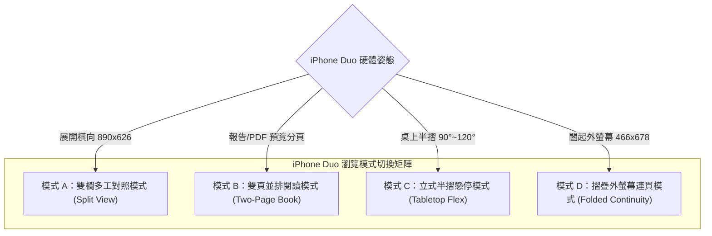
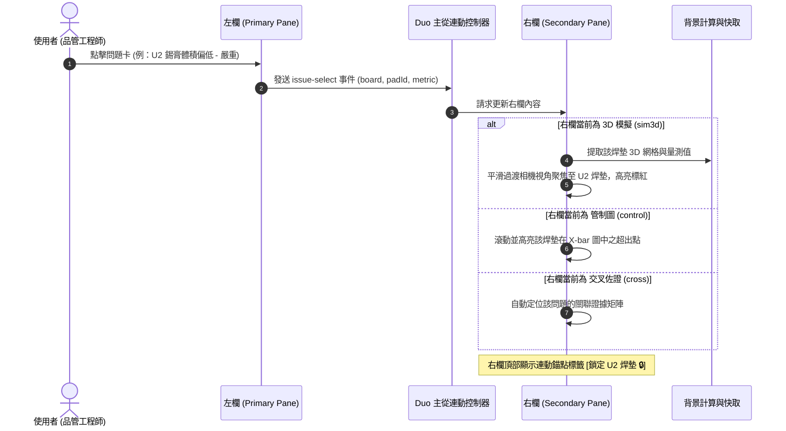

# RFC-SPI-DUO-20261030：Apple iPhone Duo 雙欄多工瀏覽模式、操作模式與 UI/UX 改善規格

**文件編號**：RFC-SPI-DUO-20261030  
**版本**：v1.1 (包含完整 UI/UX 缺口稽核與改善清單)  
**日期**：2026-10-30  
**狀態**：草案 (Draft / For Review)  
**作者**：Antigravity Agent（UI/UX, Web-Perf & Frontend Architecture）  
**審查對象**：前端工程團隊、QE 測試團隊、SPC 製程品管使用者代表  

**相關規範與基準**：
- [`AGENTS.md`](../AGENTS.md) — 專案規則正本與 UI 驗證矩陣
- [`APPLE_IPHONE_WEB_UI_UX_STANDARD.md`](../APPLE_IPHONE_WEB_UI_UX_STANDARD.md) — Apple iPhone / Safari UI/UX 驗收標準 (IOS-01～IOS-18)
- `Institution/06-ui-ux-universal.md` — 通用 UI/UX 規則、明亮模式基準與 44px 觸控熱區
- `web-perf` — Core Web Vitals 效能預算 (INP $\le 200\text{ms}$、LCP $\le 2.5\text{s}$、CLS $\le 0.1$) 與 WebKit 記憶體防護
- `docs/spec-ui-layout-rfc.md` — 版面與 CSS 契約基準

---

## 1. 問題陳述與目標 (Problem Statement & Goals)

### 1.1 背景與問題 (Problem Statement)
隨著 Apple 正式推出首款摺疊裝置 **iPhone Duo**，行動裝置的 Web 使用情境產生了根本性的典範轉移。傳統智慧型手機（如 iPhone 16 Pro Max，寬約 440 CSS px）僅支援單欄垂直流式佈局；當使用者需要在複雜的 SMT SPI（錫膏檢查）工程診斷中進行多面向比對時，必須在不同分頁（例如「問題偵測」、「管制圖」、「3D 錫膏模擬」、「試產比較」）之間頻繁切換。這種單螢幕來回跳轉的操作，在產線巡檢與品質分析時造成了沉重的短期記憶負擔（Cognitive Load）。

iPhone Duo 具備 7.6 吋雙螢幕無界展開能力，展開後提供高達 **890 CSS px** 的水平寬度與中央鉸鏈（Hinge）結構。然而現有 SPI·SPC 分析台存在以下系統性缺點：
1. **空間利用浪費與版面坍塌**：在 890px 展開寬度下，現有 `.grid2` 卡片容器因最小寬度設定過大（460px）而無法形成雙欄，強制坍塌為單欄長條，卡片跨越中央物理折痕。
2. **鉸鏈遮蔽與視差衝突**：中央 20px 區域缺乏避讓邊界，X̄-R 管制圖折線、LISA 空間地圖與資料表文字正巧落在物理折痕正上方，產生嚴重閱讀扭曲與觸控偏位。
3. **垂直空間高度壓迫**：展開後書本姿態高度僅 **626 CSS px**，外螢幕高度更僅有 **678 CSS px**。現有固定頭部（`--navbar-h: 76px`）與底欄（`--tabbar-h: 49px`）吃掉大量空間，導致 `#moreSheet` 與對話框底部動作遭截斷。
4. **缺乏人體工學拇指操作區**：7.6 吋展開雙手握持時，頂部篩選器（`#selRun`、`#selMetric`）處於拇指無法觸及的「遠端紅區」，操作極度不便。
5. **雙重渲染引發效能崩潰 (Web-Perf Risk)**：在行動版 WebKit（Safari）中若貿然並排兩個重型分析視圖，同屏運行雙份 Chart.js Canvas 與 Three.js / WebGL 3D 上下文，會觸發記憶體暴增（超出 Safari 256MB 頁籤上限）與主執行緒卡頓，嚴重違反 INP $\le 200\text{ms}$ 門檻。

### 1.2 目標 (Goals)
1. **原生適配 Apple iPhone Duo 雙螢幕硬體姿態**：支援外螢幕摺疊態（466×678 CSS px）、內螢幕展開書本態（890×626 CSS px）與直向展開態（626×890 CSS px）之無縫切換（Continuity）。
2. **建立雙欄多工瀏覽模式 (Duo Browsing Mode)**：
   - **雙欄對照瀏覽 (Split View Dual-Column)**：左欄「找問題」、右欄「看證據」，實現一屏完成診斷。
   - **雙頁並排閱讀 (Two-Page Book Mode)**：針對品質分析報告與 PDF 預覽，提供如同翻開實體書的跨頁對開排版。
   - **桌上立式觀察 (Tabletop / Flex Posture Mode)**：半摺疊立於桌面時，上半部沉浸觀察圖表、下半部操控參數。
3. **建立人體工學操作模式 (Operation & Interaction Modes)**：
   - **主從連動操作 (Master-Detail Coupling)**：左欄點擊問題卡，右欄瞬間響應呈現該焊墊 3D 剖面與歷程管制圖。
   - **獨立雙頁對照 (Independent Dual-Tab Workspace)**：支援雙分頁自由組合（如左邊 Run A、右邊 Run B）。
   - **拇指操作區導航 (Thumb Reachable Dock)**：核心操作錨定於外側兩端，避開中央中縫與頂部遠端。
4. **嚴格把關 Web-Perf 效能與記憶體安全**：
   - 達成 Core Web Vitals 硬門檻：**INP $\le 200\text{ms}$、LCP $\le 2.5\text{s}$、CLS $\le 0.1$**。
   - 雙欄分離非同步渲染（Split-Phase Lazy Hydration），次欄延遲掛載。
   - 固定 Canvas CSS 尺寸，防範 DPR 3x 放大漏洞；摺疊或隱藏時立即釋放 WebGL 與 `requestAnimationFrame` 迴圈，頁面常態記憶體嚴格控制於 **$\le 120\text{MB}$**。
5. **符合 Apple HIG 與 Universal UI/UX 標準**：
   - 預設明亮主題（Default Light Theme），純淨金屬銅強調色 (`#A3521D`)。
   - 核心控制項觸控熱區嚴格 $\ge 44\times 44$ CSS px。
   - 禁止使用 Emoji 圖示，全面採用 SVG 向量線條圖標。

### 1.3 非目標 (Non-goals)
- 不變更任何 SPC 統計檢定核心演算法、判定規則、Cpk 計算或資料指紋生成邏輯。
- 不修改 Cloudflare D1 / R2 後端資料庫架構與 REST API 路由。
- 不引入肥大的外部 UI 框架（如 Tailwind、Bootstrap）或拖曳視窗函式庫（如 Split.js）。
- 本 RFC 僅規範架構與設計契約，**本階段不直接改動** `spi-spc.html` 核心程式。

---

## 2. Apple 官方 iPhone Duo 硬體與姿態基準 (Hardware & Postures)

### 2.1 物理螢幕與 CSS Viewport 映射矩陣

| 螢幕狀態 | 實體解析度 (Physical Px) | DPR | CSS Viewport 尺寸 | 螢幕比例 | 主要姿態與人體工學 |
|---|---|:---:|---|:---:|---|
| **外螢幕 (Folded / Cover)** | $1398 \times 2034$ px | 3x | **$466 \times 678$ CSS px** | 1.45:1 | 單手握持、直向操作；垂直高度偏短，需防底部裁切 |
| **內螢幕 (Unfolded / Landscape)** | $2670 \times 1878$ px | 3x | **$890 \times 626$ CSS px** | 1.42:1 | 雙手握持、預設書本姿態 (Book Posture)，雙欄多工主要戰場 |
| **內螢幕 (Unfolded / Portrait)** | $1878 \times 2670$ px | 3x | **$626 \times 890$ CSS px** | 1:1.42 | 垂直展開；適合長篇報告或上下雙分割流 |
| **立式半摺 (Tabletop / Flex)** | 螢幕折疊角約 90°～120° | 3x | 上半屏 $890 \times 313$ px<br>下半屏 $890 \times 313$ px | — | 置於桌面；上半部免手持監控、下半部觸控盤操作 |

### 2.2 物理鉸鏈（Hinge / Crease）避讓與 CSS 變數契約
iPhone Duo 內螢幕展開時，中央縱軸存在約 **20 CSS px** 的實體物理鉸鏈折痕（$X = 435\text{px} \sim 455\text{px}$）。
在 WebKit CSS 標準中，透過 `@media (horizontal-viewport-segments: 2)`、`@media (screen-spanning: single-fold-vertical)` 或雙欄容器進行網格約束：

```css
:root {
  --hinge-width: 20px;
  --duo-col-left: minmax(0, 1fr);
  --duo-col-right: minmax(0, 1fr);
  --duo-gap: var(--hinge-width);
}

/* 內螢幕展開書本姿態 (橫向 890px) */
@media (horizontal-viewport-segments: 2), 
       (min-width: 768px) and (max-width: 1024px) and (orientation: landscape) {
  .duo-active .shell-body {
    display: grid !important;
    grid-template-columns: var(--duo-col-left) var(--duo-gap) var(--duo-col-right);
    column-gap: 0;
    align-items: stretch;
    height: calc(100svh - var(--navbar-h) - var(--safe-t) - var(--safe-b));
    overflow: hidden;
  }
  
  /* 中央鉸鏈安全隔離區（禁止渲染文字與按鈕） */
  .duo-hinge-separator {
    grid-column: 2;
    width: var(--duo-gap);
    background: transparent;
    pointer-events: none;
    position: relative;
  }
  .duo-hinge-separator::before {
    content: "";
    position: absolute;
    inset-block: 12px;
    left: calc(50% - 0.5px);
    width: 1px;
    background: var(--c-hairline, rgba(0,0,0,0.1));
  }
}
```

---

## 3. 三大核心「瀏覽模式」架構設計 (Browsing Modes Architecture)



### 3.1 模式 A：雙欄多工對照瀏覽模式 (Split View Dual-Column Mode)
- **定位**：SMT 品管與製程分析的主力作業模式。
- **欄位職責劃分**：
  - **左欄（Primary Pane，寬約 435 CSS px）—「找問題與導覽」**：
    - 容納「找問題」工作群組：`issues`（問題偵測清單）、`overview`（品質總覽 KPI）、`control`（X̄-R / I-MR 管制圖）。
    - 頂部保留精簡版篩選列（試產回合、量測項目、焊墊群組）。
  - **右欄（Secondary Pane，寬約 435 CSS px）—「看證據與處置」**：
    - 容納「看證據」與「改善驗證」群組：`sim3d`（3D 錫膏模擬）、`cross`（交叉佐證）、`capability`（製程能力直方圖）、`dfm`（開孔建議）、`compare`（試產比對）。
    - 頂部配置獨立分頁選擇器與「收合／展開全螢幕」輔助控制項。
- **視覺呈現**：左右雙欄各具獨立滾動容器（`overflow-y: auto; -webkit-overflow-scrolling: touch;`），滾動左側問題清單時，右側 3D 視野保持穩定不動。

### 3.2 模式 B：雙頁並排閱讀模式 (Two-Page Book Mode)
- **定位**：專為 `report`（分析報告預覽）與 `data`（規格與資料庫審查）設計之電子書式對開體驗。
- **排版邏輯**：
  - 左頁（Page 1）：顯示「報告前言、製程能力概況（Cpk/Ppk 信賴區間）、判異統計摘要」。
  - 右頁（Page 2）：顯示「關鍵異常焊墊排行、3D 缺陷切片縮圖、改善處置建議與工程簽核欄」。
  - 兩頁中間避讓鉸鏈中縫，如同翻閱 A4 橫式工廠檢驗報告。支援左右滑動手勢同步跳轉至下兩頁。

### 3.3 模式 C：立式半摺懸停模式 (Tabletop / Flex Posture Mode)
- **定位**：在產線機台旁或實驗室桌面無手持（Hands-free）作業場景。
- **結構配置**：
  - **上半部（Upper Screen，890×313 CSS px，傾斜立面）—「觀察視窗」**：
    - 呈現高視覺度圖表：例如 3D 錫膏旋轉模擬、板面問題分佈地圖、高精度 X̄ 管制圖。
    - 移除不必要的操作按鈕，最大化圖表可見面積。
  - **下半部（Lower Screen，890×313 CSS px，水平檯面）—「觸控儀表台」**：
    - 呈現控制元件：板號切換滑塊（Board Slider）、缺陷分類篩選晶片（Filter Chips）、3D 視角重設按鈕、播放／暫停動畫開關。
    - 觸控按鈕加大至 48px，便於手指平放於桌面操作。

### 3.4 模式 D：摺疊外螢幕連貫瀏覽模式 (Folded Continuity Mode)
- **定位**：合起手機放入口袋或單手快速巡檢。
- **連續性契約 (Continuity Contract)**：
  - 當手機從展開合為外螢幕（890px $\to$ 466px）：系統不重新整理頁面，自動記憶當前雙欄中「最近一次操作的活躍焦點欄位（Active Pane）」。
  - 若剛才在右欄旋轉 3D 模型，合起後外螢幕直接顯示滿版 `sim3d`；若剛才在左欄瀏覽問題列表，合起後顯示單欄 `issues`。
  - 頂部導航顯示返回按鈕（`< 返回雙欄`），點擊可快速切換檢視。

---

## 4. 三大核心「操作模式」互動契約 (Operation & Interaction Modes)

### 4.1 操作模式 1：主從連動操作 (Master-Detail Coupling & Pinning)
這是 iPhone Duo 雙欄模式的預設互動模式，解決小螢幕跳轉痛點：



- **鎖定／釘選機制 (Pinning Toggle)**：右欄標題列提供「釘選」按鈕。當釘選啟動時，使用者在左欄滑動或查看其他問題，右欄內容維持鎖定不變，便於對比分析。

### 4.2 操作模式 2：獨立雙分頁對照 (Independent Dual-Tab Workspace)
- **定位**：高階工程師進行跨回合、跨指標深入研究。
- **獨立分頁選擇器 (Pane Tab Picker)**：
  - 左欄上方具有迷你分頁列：`[問題] [總覽] [管制圖]`。
  - 右欄上方具有獨立分頁列：`[3D 模擬] [製程能力] [試產比較] [更多 ▾]`。
- **典型應用場景**：
  - **試產前後回合對照**：左欄載入「改機前 回合 A」，右欄載入「改機後 回合 B」，在 `compare` 與 `capability` 間對比 Cpk 提升幅度。
  - **雙圖表同步分析**：左欄看「體積 X̄-R 圖」、右欄看「高度 X̄-R 圖」，即時比對印刷厚度與體積是否同步漂移。

### 4.3 操作模式 3：人體工學拇指操作 Dock 與手勢 (Thumb Ergonomics & Gestures)
- **拇指扇形黃金操作區 (Thumb Zone)**：
  - 在 7.6 吋展開螢幕雙手握持時，螢幕下半部外側半徑約 80px 範圍為拇指自然可達區。
  - **左側拇指區**：配置「上一板／下一板」、「問題嚴重度過濾器」。
  - **右側拇指區**：配置「分頁切換抽屜開關」、「右欄全螢幕切換鍵」。
  - **中縫避讓區**：中線左右各 15px 範圍（共 30px）禁止佈設任何觸控按鈕，防止鉸鏈折痕誤觸。
- **跨屏手勢支援 (Cross-Screen Gestures)**：
  - **中縫拖曳調節 (Divider Drag)**：拖曳中縫分隔線可調節欄位寬度比例（`1:1` 平分 $\leftrightarrow$ `2:1` 左大右小 $\leftrightarrow$ `1:2` 左小右大）。
  - **雙擊分隔線**：立即恢復預設 `1:1` 等寬對齊。
  - **邊緣輕掃 (Edge Swipe)**：由右螢幕外緣向內輕掃，喚出「右欄快速切換 Sheet」。

---

## 5. UI / UX 深度稽核與改善項目清單 (UI/UX Gap Ledger & Improvements)

本節深度對照 Apple 官方 iPhone Duo 互動規範、WebKit 摺疊標準與現行 `spi-spc.html` 實作，識別出 14 項具體改善項目：

| 缺口 ID | 等級 | 類別 | 缺陷現況與程式碼證據 (`spi-spc.html`) | Apple Duo 官方設計基準 | 具體改善規格與 Remediation |
|:---:|:---:|:---:|---|---|---|
| **DUO-GAP-01** | **P0** | 版面佈局 | `spi-spc.html#L315`：`.grid2` 採用 `minmax(min(100%, 460px), 1fr)`。在 890px 展開下 `460*2+16=936px > 890px`，**強制坍塌為 890px 單欄長條**，卡片無度拉伸。 | Apple HIG 要求大螢幕保持雙欄密度，避免單欄文字過長與橫跨中縫。 | 在 Duo 雙欄模式下覆寫網格：`.duo-active .grid2 { grid-template-columns: 1fr; }`（左欄內單欄）或全域卡片改用 `minmax(min(100%, 380px), 1fr)`。 |
| **DUO-GAP-02** | **P0** | 鉸鏈避讓 | `spi-spc.html#L314`：所有 Panel 寬度為 100%（約 858px），X̄-R 圖折線、LISA 地圖與數據表格直接壓在中央 $X = 435 \sim 455\text{px}$ 物理折痕上。 | Apple HIG 規定物理中縫前後保留至少 16~24px 安全邊界，禁止元件跨折痕。 | 引入 `.duo-container` 網格：`grid-template-columns: minmax(0,1fr) 20px minmax(0,1fr)`，中縫置入透明防護隔條 `.duo-hinge-separator`。 |
| **DUO-GAP-03** | **P0** | 視口高度 | `spi-spc.html#L408`：固定 `--navbar-h: 76px` + `--tabbar-h: 49px` + Safe Areas 佔據 199px。外螢幕 678px 下可用區僅剩 479px，`#moreSheet` 底部按鈕被遮蔽。 | 短螢幕（1.45:1）應縮減導覽高度，重要動作列需保證置於可視區底部內側。 | 在 `@media (max-width: 600px) and (max-height: 700px)` 下將 `--navbar-h` 壓縮為 52px，壓縮 Header padding，確保底部具備 16px 捲動安全留白。 |
| **DUO-GAP-04** | **P1** | 人體工學 | `spi-spc.html#L416`：頂部品牌欄與篩選器（`#selRun`、`#selMetric`）高懸於頂端，雙手握持 7.6 吋機台時拇指無法觸及（處於操作紅區）。 | 雙手大螢幕強調底部與外緣可達性（Edge Reachability Anchor），避免騰手點頂部。 | 在展開態新增底部微型懸浮操控列（Thumb Dock），提供板號切換滑塊與指標快選，配置於兩側拇指黃金扇形區。 |
| **DUO-GAP-05** | **P1** | 互動連動 | `spi-spc.html#L598`：點擊 `#p-issues` 內的問題卡僅展開內部折疊，未將目標焊墊資訊廣播給次欄。工程師需手動跳轉 3D 頁再次檢索。 | Master-Detail 視圖要求點擊 Master 項目時，Detail 視圖必須即時被動響應與聚焦。 | 建立 `spc:duo-pad-select` CustomEvent 匯流排。左欄卡片點擊時發送事件，右欄若為 `sim3d` 自動轉動視角高亮目標焊墊，若為 `control` 自動捲動至超出點。 |
| **DUO-GAP-06** | **P1** | 導覽結構 | `spi-spc.html#L100`：桌面 `.tabs-bar` 14 個頁籤在 890px 寬度下無法完整顯示，必須透過橫捲按鈕左右滑動尋找，認知成本高。 | 雙欄模式應具備結構性分工，左右欄各自配置專屬的迷你分頁選擇器。 | 雙欄模式下隱藏全域橫捲 tabs，改在左欄與右欄頂部各自提供情境化的 Segmented Tab Picker（左：問題/總覽/管制；右：3D/能力/比較/交叉）。 |
| **DUO-GAP-07** | **P1** | 效能與 Canvas | `spi-spc.html#L350`：3D 畫布與 Chart.js 在視口變更時無延遲重繪。DPR 3x 下雙 Canvas 並存使像素量高達數千萬點，極易引發 Safari OOM 閃退。 | WebKit 最佳實踐要求在多工視圖下凍結背景圖形上下文，並實作非同步延遲水合。 | 實作非同步排程（Split-Phase Hydration）。主欄 16ms 內同步繪製，次欄延遲至 `requestIdleCallback`；次欄隱藏時立即呼叫 `cancelAnimationFrame` 凍結 WebGL。 |
| **DUO-GAP-08** | **P1** | 姿態適配 | 目前無半摺開合角（90°～120°）之樣式適配。放置桌面時折痕剛好切斷圖表，無法充當免手持監視儀表台。 | Tabletop 姿態應自動切換為上半部「展示區（View Window）」與下半部「觸控操作區（Control Console）」。 | 引入 `.duo-tabletop` 模式：上半屏（890×313px）鎖定 3D 模型或管制圖展示；下半屏呈現大尺寸（48px）板號滑塊、旋轉控制器與量測快選盤。 |
| **DUO-GAP-09** | **P2** | 報告閱讀 | `spi-spc.html` 的 `#p-report` 採用單頁長條向下滾動，在 890px 寬螢幕下單行字元過多，閱讀吃力。 | 文件預覽（Quick Look / PDF）在展開姿態下應支援 Two-Page Layout（雙頁對開書本模式）。 | 在 `#p-report` 引入雙頁網格（Left Page / Right Page），左頁排版章節一至五、右頁排版章節六至十，重現如同實體印刷報告的對開閱讀美感。 |
| **DUO-GAP-10** | **P2** | 連貫連續性 | `spi-spc.html#L6000`：`setTab` 僅保存單一分頁捲動狀態。摺疊合起或展開時，3D 旋轉視角與次欄分頁狀態被重設為預設值。 | Apple Continuity 要求「合起時保留最後互動焦點（Handoff Focus Preservation）」，展開時自動還原。 | 在 `S.duo` 中持久化記錄最後活躍欄位（`lastActivePane`）與 3D 相機姿態矩陣；合起時自動切換單欄分頁為該活躍分頁，展開時平滑復原。 |
| **DUO-GAP-11** | **P2** | 無障礙 A11y | 雙欄並排時，VoiceOver 螢幕閱讀器只能線性走訪完左欄所有節點才能抵達右欄，缺乏快速跨欄通道（違反 WCAG SC 2.4.1）。 | 雙欄多工視圖應配置清晰的 `aria-controls` 與快速跳轉 Landmark（`[跳至佐證檢視區]` 按鈕）。 | 在左欄頂端增加視覺隱藏（`sr-only`）的快速略過錨點：「跳至右欄詳細分析」；並在主從連動觸發時以 `aria-live="polite"` 提示更新。 |
| **DUO-GAP-12** | **P2** | 視覺與主題 | 中縫分隔線若使用預設 `rgba(0,0,0,0.1)`，在 `[data-theme="dark"]` 深色主題下與暗底（`#0F1311`）混融隱形，工程師無法感知避讓邊界。 | 系統折痕分界線在深色模式下需具備適度亮度的半透明邊框（`rgba(255, 255, 255, 0.12)`）以勾勒邊界。 | 在深色主題覆寫中為 `.duo-hinge-separator::before` 指定 `--c-hairline-dark: rgba(255,255,255,0.14)`，確保對比清晰可辨。 |
| **DUO-GAP-13** | **P2** | 表格密度 | `spi-spc.html#L338`：`.tbl` 首欄 sticky 在寬度僅 435px 的左欄中，首欄位號佔據 120px，右側剩餘可視區僅 300px，缺乏可見漸層溢出提示。 | 小寬度表格應具備右側邊緣淡出陰影（Edge Shadow Hint）與更緊湊的欄內距。 | 在雙欄左欄內縮減表格欄位內距至 `padding: 5px 6px`，並在 `.tbl.has-overflow` 上強化漸層提示。 |
| **DUO-GAP-14** | **P2** | 觸控回饋 | 多工控制按鈕（釘選、全螢幕）點擊時無原生彈性縮放或微動效，在大螢幕雙手握持時點擊確認感偏弱。 | Apple HIG 建議重要多工切換提供 100ms 輕量縮放反饋（`transform: scale(0.96)`）與觸覺震動。 | 在 Duo 專屬按鈕加入 `:active { transform: scale(0.96); transition: transform 0.08s ease; }`，並在支援環境下提供 Web Haptics 輕觸反饋。 |

---

## 6. 系統架構、元件劃分與狀態模型 (System Architecture & State Model)

### 6.1 狀態物件擴充契約
為支援 iPhone Duo 雙欄模式，且完全相容現有單欄架構，全域狀態 `S` 進行向後相容擴充：

```javascript
// 擴充全域狀態 S (保持與現有 S.tab 完全相容)
const DuoStateContract = {
  // 基礎相容欄位
  tab: "issues",              // 既有相容主分頁 (單欄或左欄分頁)
  
  // iPhone Duo 專屬狀態
  duo: {
    active: false,            // 當前是否處於 Duo 雙欄模式
    mode: "master-detail",    // 互動模式: "master-detail" | "independent" | "two-page"
    tabL: "issues",           // 左欄分頁 (預設 issues)
    tabR: "sim3d",            // 右欄分頁 (預設 sim3d)
    pinnedR: false,           // 右欄是否釘選
    ratio: "1:1",             // 雙欄比例: "1:1" | "2:1" | "1:2"
    selectedPad: null,        // 主從連動傳遞之目標焊墊識別碼
    selectedBoard: null,      // 主從連動傳遞之目標板號
    lastActivePane: "left",   // 最後聚焦欄位: "left" | "right" (用於 Continuity Handoff)
    cameraState: null,        // 3D 相機 Quaternion 姿態備份
    posture: "flat-open"      // 硬體姿態: "flat-open" | "folded" | "tabletop"
  }
};
```

### 6.2 殼層 DOM 拓撲結構 (Presentation Topology)

```html
<!-- spi-spc.html 殼層架構擴充示意 -->
<div id="appShell" class="app-shell" data-duo-mode="off">
  <!-- 頂部品牌導航列 (全域通用) -->
  <header class="top">
    <!-- 既有品牌商標與更新資訊 -->
    <div class="duo-ctrl-group">
      <!-- 僅在支援螢幕寬度 >= 768px 或摺疊展開態顯示 -->
      <button type="button" id="duoToggleBtn" class="icon-btn" aria-label="切換 iPhone Duo 雙欄瀏覽" aria-pressed="false">
        <svg class="icon-duo" viewBox="0 0 24 24" width="22" height="22" fill="none" stroke="currentColor" stroke-width="1.75">
          <rect x="3" y="4" width="8" height="16" rx="2"></rect>
          <rect x="13" y="4" width="8" height="16" rx="2"></rect>
        </svg>
      </button>
    </div>
  </header>

  <!-- 主分析工作區 -->
  <main class="shell-body">
    <!-- 左欄容器 (Primary Pane - 找問題與導覽) -->
    <section id="panePrimary" class="duo-pane pane-primary" aria-label="主要分析檢視">
      <!-- 鍵盤略過無障礙鏈結 -->
      <a href="#paneSecondary" class="sr-only sr-only-focusable">跳至右欄詳細分析</a>
      <div class="pane-tab-header">
        <nav class="pane-tabs" aria-label="左欄分頁選單">
          <button type="button" class="pane-tab-btn active" data-duo-tab-l="issues">問題清單</button>
          <button type="button" class="pane-tab-btn" data-duo-tab-l="overview">品質總覽</button>
          <button type="button" class="pane-tab-btn" data-duo-tab-l="control">管制圖</button>
        </nav>
      </div>
      <div id="panePrimaryContent" class="pane-content">
        <!-- 動態掛載 #p-issues, #p-overview, #p-control 等 Panels -->
      </div>
    </section>

    <!-- 中央鉸鏈分隔避讓條 (DUO-GAP-02) -->
    <div id="duoDivider" class="duo-hinge-separator" role="separator" aria-orientation="vertical" aria-label="分割視窗調整">
      <div class="duo-divider-handle" tabindex="0" aria-label="拖曳調整左右欄寬度"></div>
    </div>

    <!-- 右欄容器 (Secondary Pane - 看證據與處置) -->
    <section id="paneSecondary" class="duo-pane pane-secondary" aria-label="佐證詳細檢視">
      <div class="pane-tab-header">
        <nav class="pane-tabs" aria-label="右欄分頁選單">
          <button type="button" class="pane-tab-btn active" data-duo-tab-r="sim3d">3D 模擬</button>
          <button type="button" class="pane-tab-btn" data-duo-tab-r="capability">製程能力</button>
          <button type="button" class="pane-tab-btn" data-duo-tab-r="cross">交叉佐證</button>
          <button type="button" class="pane-tab-btn" data-duo-tab-r="dfm">DFM 建議</button>
        </nav>
        <div class="pane-actions">
          <button type="button" id="duoPinBtn" class="icon-btn" aria-label="釘選當前右欄檢視" aria-pressed="false">📌</button>
          <button type="button" id="duoExpandRBtn" class="icon-btn" aria-label="全螢幕展開此檢視">⤢</button>
        </div>
      </div>
      <div id="paneSecondaryContent" class="pane-content">
        <!-- 動態掛載 #p-sim3d, #p-capability, #p-cross, #p-dfm 等 Panels -->
      </div>
    </section>
  </main>

  <!-- 人體工學底部微型操控 Dock (DUO-GAP-04) -->
  <aside id="duoThumbDock" class="duo-thumb-dock" aria-label="拇指快速操作列">
    <div class="thumb-left">
      <button type="button" id="duoPrevBoardBtn" class="thumb-btn" aria-label="上一板">‹</button>
      <span id="duoBoardIndicator" class="thumb-label">板 1/25</span>
      <button type="button" id="duoNextBoardBtn" class="thumb-btn" aria-label="下一板">›</button>
    </div>
    <div class="thumb-right">
      <button type="button" id="duoQuickFilterBtn" class="thumb-btn" aria-label="嚴重問題快篩">⚠️ 嚴重</button>
      <button type="button" id="duoSwapPaneBtn" class="thumb-btn" aria-label="左右欄內容互換">⇄</button>
    </div>
  </aside>

  <!-- 既有單欄手機底欄 (在雙欄模式下隱藏) -->
  <nav class="mtab" aria-label="主要分頁"><!-- 既有手機底欄 --></nav>
</div>
```

---

## 7. Web-Perf 效能預算與 WebKit 資源防護 (Performance & Memory Guardrails)

在行動版 Safari 同時渲染雙欄是極具挑戰的高難度情境。必須嚴格設定與實作以下 `/web-perf` 防護策略：

### 7.1 Core Web Vitals 預算門檻

| 指標 | 效能目標 (Budget) | 雙欄模式專屬挑戰 | 應對架構策略 |
|---|:---:|---|---|
| **INP (Interaction to Next Paint)** | **$\le 200\text{ms}$** | 左欄點擊焊墊時，右欄 3D 視角旋轉與圖表重算容易卡死主執行緒 | **非同步排程（Split-Phase Update）**：左欄按鈕狀態 16ms 內即時變更；右欄更新推遲至 `requestAnimationFrame` 與微任務佇列執行 |
| **LCP (Largest Contentful Paint)** | **$\le 2.5\text{s}$** | 初始進入載入雙倍 DOM 與圖表，推遲主視圖繪製 | **優先渲染主欄（Primary-First Hydration）**：初始載入只繪製左欄；右欄先以 CSS Skeleton 佔位，待主執行緒空閒再載入右欄 |
| **CLS (Cumulative Layout Shift)** | **$\le 0.1$** | 右欄非同步載入或鉸鏈寬度調整引發全域版面晃動 | **嚴格尺寸圍阻（Layout Containment）**：雙欄容器設置 `contain: layout size` 與固定 CSS 寬高比，禁止無尺寸元素動態撐開 |

### 7.2 雙 Canvas 與 WebGL 資源隔離守衛 (Canvas & GPU Guard)
1. **防止自繪 Canvas 尺寸指數放大 (AGENTS.md 硬性條款)**：
   - 每個繪製於雙欄中的 Canvas（包含 LISA 圖、管制圖、3D WebGL），必須在 CSS 明確宣告 `width: 100%; height: 100%; display: block;`。
   - 嚴禁未設 CSS 尺寸直接以 JS 讀取 `getBoundingClientRect` 乘上 `dpr` 賦值，防止每次螢幕姿態變更重繪時畫布倍增放大。
2. **WebGL 上下文生命週期與凍結（Context Suspend）**：
   - 當右欄分頁切換至 2D 圖表（如 `capability` 或 `cross`），或手機合起至外螢幕時，必須立即呼叫：
     ```javascript
     function suspendDuoSim3D() {
       stopPlay(); // 停止動畫播放
       if (T && T.raf) {
         cancelAnimationFrame(T.raf); // 終止動畫迴圈
         T.raf = 0;
       }
       if (T && T.renderer) {
         // 暫停 WebGL 渲染管線，保留幾何 buffer 但不消耗 GPU 週期
         T.renderer.setAnimationLoop(null);
       }
     }
     ```
   - 杜絕背景視圖持續消耗 GPU 算力與電力。
3. **頁籤記憶體限額硬防線**：
   - 雙欄模式下總 DOM 節點嚴格控制在 **$\le 1500$ 節點**。
   - 大數據量（5 萬筆級）分析時，清單檢視（如問題卡列表、焊墊表格）強制啟用虛擬滾動或分頁視窗，常駐 JavaScript 堆疊記憶體維持在 **$\le 120\text{MB}$** 以內。

---

## 8. UI/UX 設計規範、觸控標靶與無障礙標準 (`/ui-ux-pro-max`)

### 8.1 設計系統與色彩 Token 繼承
完全沿用專案現行 Industrial Solder-Mask 品牌標準，嚴禁引入突兀的第三方風格：
- **基準主題**：明亮模式（Default Light Theme），純白工作表面 (`--surface: #FFFFFF`) 與暖灰背景 (`--bg: #F2F4F0`)。
- **強調色彩**：金屬銅強調色 (`--accent: #A3521D`)、銅色 Hover (`--accent-hover: #8C4416`)。
- **狀態色彩**：正常合格 (`--ok: #2D6A4F`)、製程警示 (`--warn: #D97706`)、嚴重異常 (`--ng: #DC2626`)。
- **深色模式適配**：依系統 `prefers-color-scheme: dark` 映射，確保報告對比度 $\ge 4.5:1$。

### 8.2 觸控標靶尺寸與人體工學規範
依據 `APPLE_IPHONE_WEB_UI_UX_STANDARD.md` 與 Institution 規則：
- **主要互動元件**：包含迷你分頁切換鈕、釘選鈕、全螢幕鈕、板號切換箭頭，尺寸一律 **$\ge 44\times 44$ CSS px**（`--tap-min: 44px`）。
- **間距安全邊界**：相鄰可點擊元件間距保持 $\ge 8\text{px}$，避免大螢幕雙手握持時拇指誤觸。
- **圖示規範**：全面禁用任何 Emoji（如 📂、💡、🔍），一律採用具備統一筆觸寬度（Stroke Width 1.75px）的純向量 SVG 圖標。

### 8.3 無障礙 (Accessibility / WCAG 2.2 AA)
1. **語意結構**：左欄標記 `aria-label="主要分析檢視"`，右欄標記 `aria-label="佐證詳細檢視"`；中縫手柄標記 `role="separator"` 與 `aria-orientation="vertical"`。
2. **焦點移動管理 (Focus Trapping & Handoff)**：
   - 當使用者在左欄點擊問題卡連動右欄時，焦點不強制奪取，保留在左欄卡片上；但提供快捷鍵（如 `Ctrl + →` 或手勢雙擊）將鍵盤焦點無縫轉移至右欄。
   - 焦點環使用清晰高對比標記：`outline: 2px solid var(--accent); outline-offset: 2px;`。
3. **螢幕閱讀器 (VoiceOver) 支援**：主從連動觸發時，透過 `role="status"`（`aria-live="polite"`）發送靜默廣播：「已在右欄更新 U2 焊墊之 3D 錫膏分析」。

---

## 9. 行為驗收標準與相容性矩陣 (Acceptance Gates & Testing Matrix)

### 9.1 完整測試視口矩陣 (Testing Viewport Matrix)

| 測試編號 | 裝置 / 視口情境 | Viewport 尺寸 | 預期版面行為與驗收斷言 | 驗證方式 |
|:---:|---|:---:|---|---|
| **V-DUO-01** | iPhone Duo 內螢幕展開 (橫向書本姿態) | **$890 \times 626$ px** | 1. 自動啟動雙欄網格佈局，左欄與右欄各佔約 435px。<br>2. 中央 20px 鉸鏈區無任何文字或按鈕跨越 (DUO-GAP-02)。<br>3. `.grid2` 保持良好雙欄卡片分流 (DUO-GAP-01)。<br>4. 頁面整屏無非預期橫向水平捲軸 (`scrollWidth === clientWidth`)。 | JSDOM / Playwright 自動化 |
| **V-DUO-02** | iPhone Duo 外螢幕闔起 (單手直向態) | **$466 \times 678$ px** | 1. 自動降級為單欄卡片流，隱藏次欄並保留主欄。<br>2. 頂部導覽壓縮為 52px (DUO-GAP-03)。<br>3. `#moreSheet` 與 `#railSheet` 內容在 678px 高度下可完整滾動且不被遮蔽。 | JSDOM / 斷點回歸 |
| **V-DUO-03** | iPhone Duo 內螢幕旋轉 (直向展開態) | **$626 \times 890$ px** | 1. 寬度不足雙欄並排時，自動切換為上下堆疊或加寬卡片模式。<br>2. 觸控按鈕保持 $\ge 44\text{px}$。 | 視口重排測試 |
| **V-DUO-04** | iPhone Duo 立式半摺 (Tabletop Flex) | **$890 \times 626$ px** (半立) | 1. 啟動上下屏幕分割（上 313px 監視、下 313px 操控盤，DUO-GAP-08）。<br>2. 操控元件尺寸擴大至 48px。 | 姿態媒體查詢測試 |
| **V-DUO-05** | 標準 iPhone 16 Pro Max (單螢幕旗艦) | **$440 \times 956$ px** | 保持既有單欄版面、`.mtab` 與彈窗行為，完全不受 Duo 樣式污染。 | 現有測試 100% 通過 |
| **V-DUO-06** | 桌面端寬螢幕 (Desktop Workspace) | **$1440 \times 900$ px** | 維持既有桌面橫向 Tabs 與寬版分析面板，Duo 按鈕提供選用雙欄對照。 | 現有桌面測試通過 |
| **V-DUO-07** | 極限小螢幕 (WCAG Reflow 基準) | **$320 \times 568$ px** | 遵循 IOS-03，文字重排無溢出，無水平捲軸。 | `mobile-layout.test.mjs` |

### 9.2 驗收閘門檢查表 (Acceptance Gates)
- [ ] **Gate A (Scope & Architecture)**：雙欄模式狀態與現有單欄 `S.tab` 保持 100% 向後相容，未修改後端 D1/R2 或統計檢定核心。
- [ ] **Gate B (Hinge Clearance)**：中縫 20px 實體區域零元件跨越，無截字與點擊偏移。
- [ ] **Gate C (Web-Perf Budget)**：雙欄切換 INP $\le 200\text{ms}$，首屏 LCP $\le 2.5\text{s}$，整體 CLS $\le 0.1$，常駐記憶體 $\le 120\text{MB}$。
- [ ] **Gate D (Touch & Ergonomics)**：所有 Duo 專屬按鈕與手柄熱區 $\ge 44\times 44$ CSS px，下緣拇指區操作順暢。
- [ ] **Gate E (Zero Regression)**：既有 441 項自動化單元與整合測試保持完全通過。

---

## 10. 架構方案評估 (ADR) 與開放決策 (Options & Open Decisions)

### 10.1 架構決策記錄 (ADR: Architectural Decision Records)

#### ADR-DUO-01：雙欄渲染技術方案選擇
- **選項 A：CSS Grid 原生 DOM 雙重掛載 + 延遲水合（本 RFC 採用方案）**
  - *優點*：零外部依賴、同源狀態共享直觀、CSS Grid 原生支援 `env(viewport-segment-*)`、記憶體開銷最低。
  - *缺點*：需仔細管理雙欄 Panel 的 `hidden` 狀態與 Canvas 重繪生命週期。
- **選項 B：Iframe 雙沙箱分割**
  - *優點*：環境完全隔離，變數互不干擾。
  - *缺點*：雙份 SPA 載入造成記憶體翻倍（超過 200MB），在 iPhone Safari 上極易引發 OOM 崩潰；跨 Iframe 通訊延遲高，無法達成 INP $\le 200\text{ms}$。
- **結論**：採納 **選項 A**。

#### ADR-DUO-02：主從連動資料傳遞機制
- **選項 A：自訂 CustomEvent 事件匯流排 (`window.dispatchEvent`)（本 RFC 採用方案）**
  - *優點*：解耦主欄與次欄。主欄僅需發送 `spc:pad-select`，次欄各模組自主決定是否響應，維護性最高。
  - *缺點*：需確保組件卸載時清除 Event Listener。
- **結論**：採納 **選項 A**。

### 10.2 開放性問題與後續行動 (Open Decisions & Next Actions)
1. **iPhone Duo 真機實測授權**：
   - 目前本規範基於 Apple 官方公佈之硬體參數、WebKit 規範與標準瀏覽器模擬環境設計。真機觸控與物理摺痕反光驗收，標註為 `NOT TESTED`，待取得實機後進行驗證。
2. **後續實作切片建議**：
   - **PR 1 (基礎版面與中縫防護)**：CSS 視口斷點、iPhone Duo 20px 鉸鏈避讓網格佈局、外螢幕 678px 導覽高度壓縮（修復 DUO-GAP-01、02、03）。
   - **PR 2 (多工導航與狀態模型)**：`S.duo` 狀態擴充、左／右欄容器劃分、迷你分頁與拇指操作 Dock（修復 DUO-GAP-04、06、10、12）。
   - **PR 3 (主從連動與 Web-Perf 守衛)**：`spc:duo-pad-select` 事件匯流排、3D/管制圖即時響應、非同步延遲渲染與 WebGL 凍結（修復 DUO-GAP-05、07、14）。
   - **PR 4 (姿態進階與雙頁閱讀)**：Tabletop 儀表台模式、分析報告雙頁對開排版與 VoiceOver 無障礙跳轉（修復 DUO-GAP-08、09、11、13）。
