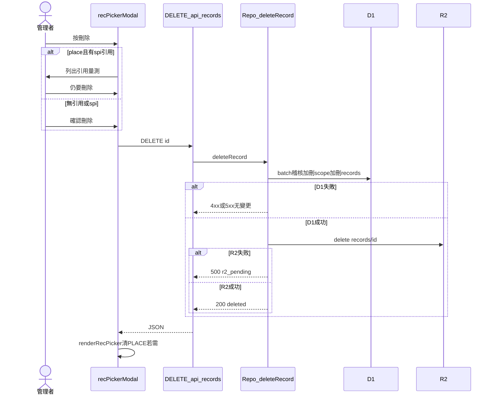

# RFC-SPI-REC-DEL-20261111：量測紀錄與座標檔資料庫刪除

**文件編號**：RFC-SPI-REC-DEL-20261111  
**狀態**：草案（For Review）  
**日期**：2026-11-11  
**關聯**：[spec-database-management-rfc.md](spec-database-management-rfc.md)、[rfc-controlled-coordinate-import.md](rfc-controlled-coordinate-import.md)、[spec-record-place-proof-rfc.md](spec-record-place-proof-rfc.md)

本規格不構成發布授權。核准後方得進行實作 PR。

> **實作以 [spec-record-file-manager-rfc.md](spec-record-file-manager-rfc.md) 為準**（下列與該契約衝突時不採用）：不使用 6 秒 `PICKER_CONFIRM` 連點，改為記錄庫內確認對話框；R2 刪除失敗仍回 200，不回 `r2_pending`；刪除目前座標後頂欄顯示「座標檔：雲端檔已刪除」，而非僅「未套用」。

---

## 1. 問題陳述與目標

### 1.1 問題

量測記錄與座標檔資料庫（`#recPickerModal`，頂欄「記錄庫」）已具搜尋、篩選、載入、選取、驗證、匯出原始檔、封存座標檔，以及管理者修改中繼資料與備註。但**管理者無法從同一介面永久刪除**誤登、重複上傳或不再使用的量測紀錄與座標檔原檔。

現行產品敘述與程式行為仍傾向「原始檔須保留」：

- 雲端 `RecDB.del` 走 `DELETE /api/records?id=`，但 [`lib/repo.mjs`](../lib/repo.mjs) 的 `deleteRecord` 對 `kind === 'spi'` 或 `kind === 'place'` 一律回 **409**（「量測與座標原始檔須保留，請使用封存或修正流程」）。
- 記錄庫的桌面表與手機卡片**未渲染「刪除」按鈕**；`data-pact="del"` 的兩段確認邏輯仍存在，屬死路。
- 隱藏子頁 `#recCard` 的 `renderRecords()` 將刪除按鈕函式寫死為 `const del = () => ""`。
- **封存**僅讓座標檔不再供新匯入；`(part, rev, side)` 在 `coordinate_scopes` 仍被該紀錄占用，無法以刪除以外的方式釋放正式版次範圍（除非另做 migration／手動維運）。

使用者已確認刪除語意：**管理者可永久刪除**（移除 D1 中繼列與 R2 `records/{id}` 原檔；`audit_log` 保留）。座標檔若仍有量測引用，**允許刪除**，但 UI 必須先列出引用並要求額外確認。

### 1.2 目標

1. **完整檔案管理**：在記錄庫的量測記錄與座標檔兩分頁，管理者於桌面表與手機卡片均可執行「刪除」，與既有「匯出」「驗證」「封存」等並列。
2. **破壞性操作可審計**：每次成功刪除寫入 `audit_log`（`action=delete`），detail 含 kind、批號、料號、版次、檔名、SHA-256、位元組、原上傳時間與上傳者；`audit_log` 列永不刪除（後續由 [RFC-SPI-AUDIT-DEL-20261112](spec-audit-log-delete-rfc.md) 調整為管理者可刪、刪除留下墓碑列）。
3. **引用可見再決策**：刪除座標檔前，列出仍 `place_id` 指向該 id 的量測（清單經 `topList`，最多 10 筆＋「另 N 筆」）；有引用時須兩段確認（含「仍要刪除」）。
4. **客戶端狀態一致**：刪除後若該筆為目前選取之座標檔或目前回合來源量測，清除套用狀態並更新頂欄晶片；開啟仍引用已刪座標的量測時，沿用既有「座標檔無法取回，這次不套用」路徑。
5. **伺服器單一權限來源**：僅 `admin_roles` 可刪 `spi`／`place`；一般使用者不見刪除按鈕，API 非管理者回 403。

### 1.3 非目標

- 不實作批次刪除、回收站、刪除還原，或依檔名字樣自動清理。
- 不變更料號規格（`kind=spec`）刪除規則（仍限原上傳者，本 RFC 不涵蓋）。
- 不變更封存、`new_batch`、`correct`、受控座標登錄、對應證明 API 語意。
- **不連動刪除**引用該座標的量測紀錄；**不清空**其他量測列上的 `place_id`（歷史引用欄位保留，唯原檔與座標紀錄不存在）。
- 不撤銷或刪除獨立 `shares/{id}` 分享複本。
- 本文件起草階段**不修改** [`rfc-controlled-coordinate-import.md`](rfc-controlled-coordinate-import.md)、[`AGENTS.md`](../AGENTS.md) 或程式；實作 PR 須同步更新與「原始檔須保留」矛盾的測試與文件（見 §4.4）。

---

## 2. 系統架構

### 2.1 元件職責

| 元件 | 職責 |
|---|---|
| `spi-spc.html` — `#recPickerModal` | 渲染刪除鈕、確認對話框、呼叫 `RecDB.del`、重繪清單與同步 `PLACE`／`LOAD_ERROR`／頂欄狀態 |
| `spi-spc.html` — `#recCard`（若仍掛載） | 與記錄庫共用同一刪除入口與確認流程，避免雙軌行為 |
| `RecDB.del`（cloud） | `DELETE /api/records?id=` |
| `cloudflare/worker.mjs` | 已要求管理者；轉呼叫 `repo.deleteRecord` |
| `lib/repo.mjs` — `deleteRecord` | 擴充支援 `spi`／`place` 之原子 D1 批次與 R2 刪除 |
| D1 `records` / `coordinate_scopes` / `audit_log` | 中繼、座標版次占用、稽核 |
| R2 `records/{id}` | 量測或座標 Gzip 原檔 |

### 2.2 資料流（管理者刪除一筆紀錄）



### 2.3 與現有刪除相關的事實（實作前基線）

- `coordinate_scopes.record_id` 參照 `records(id)`（migration `0007`），無 `ON DELETE CASCADE`；須在同一 D1 batch 內先刪 `coordinate_scopes` 再刪 `records`。
- 量測之 `place_id` 為邏輯引用，無 FK。
- 現行 `deleteRecord` 在 D1 成功後刪 R2，R2 例外被 `catch {}` 忽略，可能出現「D1 已無、R2 殘留」且 API 仍回成功。
- 座標「驗證」已能列引用量測（`showPlaceProof`）；刪除確認可重用相同查詢條件：`records WHERE kind='spi' AND place_id=?`（含 lifecycle 各態）。

---

## 3. 資料模型與介面

### 3.1 刪除範圍矩陣

| kind | 誰可刪 | D1 | R2 | coordinate_scopes | 其他量測 place_id |
|---|---|---|---|---|---|
| `spi` | 管理者 | 刪 `records` 列 | 刪 `records/{id}` | 不適用 | 不變 |
| `place` | 管理者 | 刪 `records` 列 | 刪 `records/{id}` | 刪該 `record_id` 列 | **不變**（引用仍指向已刪 id） |
| `spec` | 原上傳者（既有） | 既有邏輯 | 既有邏輯 | 不適用 | 不適用 |

### 3.2 API 契約：`DELETE /api/records?id={id}`

**前置**：請求者為管理者（`admin_roles`）；`id` 符合 `ID_RE`。

**流程**（`kind` 為 `spi` 或 `place` 時）：

1. `getRecord(id)`；若不存在，嘗試 R2 `delete records/{id}`（orphan 清理）。D1 與 R2 皆無則 **404**。
2. 組裝 `audit_log.detail` JSON：`kind`, `lot`, `part`, `rev`, `side`, `name`, `sha256`, `bytes`, `uploaded`（`created`）, `uploader`（`user`）；座標刪除可選加 `referenced_spi_count`（僅供稽核閱讀，不影響授權）。
3. **單一 D1 batch**（順序固定）：
   - `INSERT INTO audit_log ... action='delete' ...`
   - `DELETE FROM coordinate_scopes WHERE record_id = ?`（`place` 時；`spi` 可省略或 no-op）
   - `DELETE FROM records WHERE id = ?`
4. batch 任一步失敗 → 回傳錯誤，**不**觸 R2。
5. batch 成功 → `R2.delete('records/{id}')`。失敗 → **500**，body 含可機讀欄位，例如：
   ```json
   { "error": "中繼已刪除，原始檔尚在雲端儲存", "code": "r2_pending", "id": "..." }
   ```
   客戶端可提示管理者重試同一 DELETE 以清 orphan R2（此時 D1 無列，步驟 1 走 orphan 分支）。
6. 全程成功 → **200** `{ "deleted": "<id>" }`。

**禁止**：`DELETE` 不得用於覆寫原檔；`POST`/`PUT` 覆寫量測或座標原檔仍不接受。

**非管理者**：**403** `{ "error": "需要管理者權限" }`（與現行 Worker 一致）。

### 3.3 前端契約（`#recPickerModal`）

| 項目 | 規格 |
|---|---|
| 顯示條件 | `RecDB.isAdmin === true` 且已登入雲端 |
| 按鈕文案 | 「刪除」；確認態第二段「仍要刪除」僅在有引用之座標檔 |
| 確認內容 | 料號、版次、面別（座標）或批號（量測）、檔名、SHA-256 前 10 字＋省略、上傳者、上傳時間 |
| 引用清單 | 座標刪除且 `referenced_spi_count > 0`：以 `topList` 顯示批號／工單／日期／檔名摘要 |
| 對話框按鈕順序 | 確認／仍要刪除在左，取消在右 |
| 進行中 | 停用觸發鈕，文案「正在刪除…」 |
| 成功 | Toast；`renderRecPicker(true)`；`renderRecords(true)`；若 `#recAuditBox` 已展開則 `renderAudit()` |
| 頁尾說明 | 改為「原始檔不可修改；管理者可刪除，刪除後稽核保留」 |
| 焦點 | 刪除完成後焦點留在清單區，不困在已消失列 |

**兩段確認狀態機**（與現有 `PICKER_CONFIRM` 對齊）：

1. 第一次點「刪除」→ 列上或對話框進入確認態（6 秒逾時可取消，與現有 `setTimeout` 行為一致）。
2. 座標且有引用：第一次僅顯示引用與警告；須再按「仍要刪除」才呼叫 API。
3. 第二次確認 → `RecDB.del(id)`。

**刪除後客戶端狀態**（與現有 `data-pact="del"` 區塊對齊並補齊）：

- `PLACE.recId === id` → 清空 `PLACE`，`placeSave()`，`placeShow()`。
- `runSrc(curRun())?.id === id` → 設定 `LOAD_ERROR.spi` 或清除來源標記，更新 `#stateSpi`／`#statePlace`。
- **刪除目前套用之座標檔**時，僅清 `PLACE` 不足：`updateLoadStates()` 仍可能因 `run.info.src.placeId` 或 `run.info.placePreview` 將頂欄顯示為「座標檔：已套用」，`componentX/Y` 等預覽座標也可能殘留列上。實作須依刪除目標分支處理：
  - 刪除的 id 等於 `PLACE.recId`，或等於 `runSrc(curRun())?.placeId`，或等於 `run.info.placePreview?.recId` → 清空 `PLACE` 後對 `curRun()` 呼叫 `syncPlaceToCurrentRun({ notify: false })`（`PLACE` 為 null 時會走 `clearPlacePreviewFromRun`，清預覽座標並 `build3D()`）。
  - 若刪除的 id 等於目前回合量測來源 `runSrc(curRun())?.id` → 另依上列清除 `run.info.src` 相關標記或設定 `LOAD_ERROR.spi`，再 `updateLoadStates()`。
  - 一律 `saveRunsSoon()` 在 `syncPlaceToCurrentRun` 路徑內已涵蓋；禁止只 `placeShow()` 而未同步回合預覽狀態。
- `delete REC_VER[id]`。

### 3.4 實作 PR 須同步的測試／文件

| 資產 | 變更 |
|---|---|
| [`tests/records-ui.test.mjs`](../tests/records-ui.test.mjs) | 移除「正式量測沒有刪除鈕」與「拒絕刪除 spi」之期望；新增管理者刪除成功與非管理者無鈕／403 |
| [`tests/controlled-repo.test.mjs`](../tests/controlled-repo.test.mjs) | `deleteRecord` 對 `spi`／`place` 改期望成功（含 scope 刪除順序） |
| [`CHANGELOG.md`](../CHANGELOG.md) | 使用者可見：記錄庫管理者可刪除量測與座標原檔 |
| [`rfc-controlled-coordinate-import.md`](rfc-controlled-coordinate-import.md) 或 README | 註明「原始檔可經管理者刪除；稽核保留」取代單向「須保留」敘述（實作 PR 一併處理） |

### 3.5 UI 驗收矩陣（實作完成後）

依 `AGENTS.md`「UI 改動的驗證矩陣」：**build 產物**（非 dev server），寬度 **1440／820／390／320** CSS px，各跑**明亮與深色**；`devicePixelRatio > 1` 下記錄庫分頁至少進出兩次。

| 檢查項 | 範圍 |
|---|---|
| 橫向溢出 | 開啟 `#recPickerModal`、刪除確認／引用警告對話框：`documentElement.scrollWidth === clientWidth` |
| 觸控熱區 | 刪除／仍要刪除／取消按鈕與手機卡片動作列 ≥44px（含 `@media (pointer:coarse)`） |
| 文字對比 | 破壞性確認與錯誤態在兩主題下可讀 |
| 角色／權限 | 記錄庫 → 量測與座標分頁：管理者見刪除；一般使用者不見 |
| 刪除流程 | 座標分頁：有引用須兩段確認；無引用一次確認 |
| 狀態同步 | 刪除目前選取之座標後頂欄「座標檔：未套用」；若回合曾顯示 `placePreview`，刪除後不得仍顯示「已套用（檢視）」 |
| 稽核 | 刪除列寫入 audit；舊列對已刪 id 顯示「目標已不在本站」 |
| R2 失敗 | 測試 stub 顯示 `r2_pending` 類訊息且可重試 |

---

## 4. 安全、效能與上線

### 4.1 威脅模型

| 風險 | 緩解 |
|---|---|
| 非管理者刪除 | Worker＋Repo 雙層 `isAdmin`；前端隱藏按鈕不作为授權 |
| 誤刪生產資料 | 兩段確認；座標引用明示；建議實作 PR 不在本 RFC 強制第二次 `window.prompt` |
| 稽核否認 | 先寫 `audit_log` 再刪列；失敗 batch 撤回 |
| 殘留 R2 洩漏 | `r2_pending` + 重試 DELETE；維運可對照 audit 與 R2 清單 |
| ID 注入 | 沿用 `ID_RE`；SQL 參數綁定 |
| 大量引用字串膨脹 | 刪除對話框引用清單必須 `topList(..., 10)` |

### 4.2 效能

- 單筆刪除：1 次 D1 batch（≤3 陳述式）+ 1 次 R2 delete；引用計數與列表可併入既有 list cache 或單次 `SELECT id, lot, name ... LIMIT 101`。
- 不掃全表；不依刪除路徑觸發 `test:slow`。

### 4.3 上線與回退

- **無新 migration**（沿用 `0007` schema）。
- **無功能旗標**；部署後管理者即可刪除。
- **回退**：還原 Repo／UI 至 409 行為；已刪除之 D1／R2 **無法**由回退自動恢復（需備份還原，與 AGENTS 雲端維運規則一致）。
- 合併前：本地 `npm test` 含更新後 `records-ui`、`controlled-repo`；統計變更無則不重跑 `test:slow`。
- 發布後驗收：正式 Worker 登入管理者 → 記錄庫刪除測試用紀錄（非生產批）→ 確認 audit API 與清單少一筆；**不可**僅驗登入頁版本。

### 4.4 與專案規則的銜接

實作 PR 若更新 `AGENTS.md` 中「原始檔只可新增」敘述，須改為「原始檔不可就地修改；管理者可刪除量測與座標原檔，稽核保留」，並保留 WORM **語意上的不可篡改**（無 PATCH 覆寫原檔 bytes）。

---

## 5. 驗收條件（Given / When / Then）

1. **Given** 管理者已登入、存在一筆無引用的座標檔 **When** 於記錄庫完成刪除 **Then** D1 無該 id、`coordinate_scopes` 無該 `record_id`、R2 無物件、audit 有 delete 列。
2. **Given** 座標檔被至少一筆量測 `place_id` 引用 **When** 管理者刪除 **Then** UI 曾顯示引用清單且須兩次確認；刪除後引用量測的 `place_id` 字串不變；開啟該量測不套用座標。
3. **Given** 管理者 **When** 刪除一筆量測 **Then** 該筆自清單消失；若為目前回合來源則頂欄狀態更新。
4. **Given** 非管理者 **When** 呼叫 DELETE **Then** 403；UI 無刪除鈕。
5. **Given** D1 batch 已成功、R2 delete 失敗 **When** API 回應 **Then** 客戶端顯示 `r2_pending` 類訊息；重試 DELETE 可清 R2 且不重複寫 audit（orphan 路徑）。
6. **Given** 目前回合以 `placePreview` 或 `PLACE` 套用被刪座標 **When** 管理者刪除該座標檔 **Then** 頂欄座標狀態為未套用／錯誤可見；3D 不再顯示已刪預覽佈局（`componentX/Y` 已清）。

---

**核准欄**（留空）：產品／品保工程 __________　日期 __________
