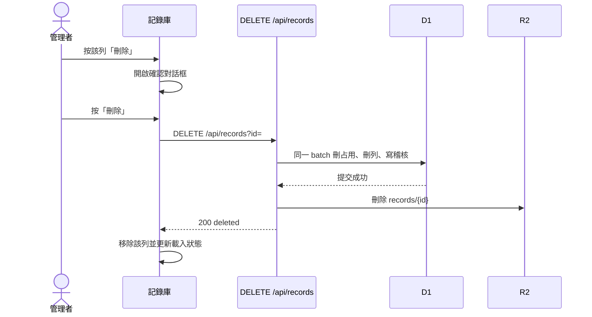

# RFC-SPI-FILE-20261112：量測紀錄與座標檔的檔案管理與刪除

狀態：草案，待實作。本文件不構成發布授權，也不授權套用 migration。

本步只定義行為。實作前不得新增路由、migration 或規則檔。

---

## 1. 問題、目標與非目標

### 問題

記錄庫 `#recPickerModal` 已是量測紀錄與座標檔的檔案管理畫面：可搜尋、篩選、載入或選取、驗證、匯出。座標檔另有管理者封存與登錄表單。刪除沒有入口。

- `spi-spc.html` 的 `delBtn` 固定回傳空字串，桌面表與手機卡片都不會畫出刪除鈕。`data-pact="del"` 的點擊處理與 6 秒連點確認 `PICKER_CONFIRM` 仍留在程式裡，畫面上按不到。
- 雲端 `Repo.deleteRecord` 對 `kind` 為 `spi` 或 `place` 直接回 409，訊息是「量測與座標原始檔須保留，請使用封存或修正流程」。`DELETE /api/records?id=` 在進到這段之前還要求管理者。
- 封存只把座標 `lifecycle` 改成 `archived`，R2 原檔與 `coordinate_scopes` 的 `(part, rev, side)` 占用都還在。量測的「修正既有」把舊檔標成 `superseded`，新舊兩份原檔都留著。這兩條路都不能把檔案從資料庫拿掉。
- `tests/records-ui.test.mjs` 斷言正式量測沒有 `[data-pact=del]`，且 `RecDB.del` 被拒後紀錄仍在。`tests/controlled-repo.test.mjs` 斷言刪除量測回 409。

管理者因此無法清掉傳錯、重複或不再使用的雲端原檔。版次被封存檔占用時，也不能用同一正式版次登錄更正後的座標。

### 目標

1. 已登入的管理者可在記錄庫的量測紀錄頁與座標檔頁，對任一筆這兩類雲端檔執行硬刪除。
2. 硬刪除在同一個 D1 batch 移除該列與它的座標占用，寫入不可刪的稽核，再移除 R2 `records/{id}`。
3. 刪除前用記錄庫內的確認對話框寫明檔名、身分與影響。刪除後清單、目前載入狀態與稽核頁一致。
4. 兩頁既有的載入、選取、驗證、匯出、封存與修正動作保持可用，刪除只補上缺少的檔案操作。

### 非目標

- 不做回收桶、還原、批次刪除、資料夾或原檔重新命名。
- 不新增 API 路徑，不改 `records`、`coordinate_scopes` 或 `audit_log` 的 schema。
- 不開放非管理者刪除。未登入與本機 IndexedDB 舊資料維持唯讀。
- 不改料號規格的刪除規則、座標封存、量測「新一批」與「修正既有」。
- 不改寫其他列的 `place_id` 或 `supersedes_id`。
- 不自動晉升另一份座標為預設，也不自動刪掉畫面上的分析回合。

舊規格裡「原始檔只能由上傳者刪除」（`docs/spec-database-management-rfc.md`）以及「修正時兩份原檔都保留」（`docs/rfc-controlled-coordinate-import.md`）仍適用於它們各自描述的路徑。本規格只新增一條由管理者明確發起的硬刪除。自動衝突處理仍不得覆寫或刪除既有版本。

---

## 2. 系統架構

### 元件

| 元件 | 責任 |
|---|---|
| `#recPickerModal` 量測紀錄頁、座標檔頁 | 列出檔案、既有操作，以及管理者的「刪除」 |
| 刪除確認對話框 | 顯示身分與影響；左「刪除」、右「取消」 |
| `RecDB.del` | 已登入時送 `DELETE /api/records?id=`；本機模式維持拋錯 |
| `cloudflare/worker.mjs` 的 `DELETE /api/records` | 非管理者回 403；通過後呼叫 `Repo.deleteRecord` |
| `Repo.deleteRecord` | 對 `spi` 與 `place` 放行硬刪除；`spec` 仍只限上傳者 |
| D1 `records`、`coordinate_scopes`、`audit_log` | 列、版次占用與稽核 |
| R2 `records/{id}` | 原始檔本體 |

不新增頁面、路由或資料表。

### 資料流

取消、關閉對話框或按 Escape 不送請求。請求進行中，「刪除」與「取消」都不可再按，狀態文字為「刪除中」。

---

## 3. 資料模型與介面

### 實體與刪除後的關係

- 刪除對象是一筆 `records`，`kind` 為 `spi` 或 `place`。`active`、`pending_review`、`superseded`、`archived`、`legacy` 都可刪。
- 座標檔若在 `coordinate_scopes` 有列，同一 batch 先 `DELETE FROM coordinate_scopes WHERE record_id = ?`，再刪 `records` 列。雙面檔的 TOP 與 BOT 占用一起釋放。沒有占用列的歷史座標仍可刪。
- 釋放後，相同料號、版次與面別可以再登錄另一份受控座標。封存不釋放占用，封存與刪除並存，語意不同。
- 其他量測的 `place_id` 保持原值。清單與證明沿用 `placeText`：找不到座標時顯示「✗ 座標檔不存在」。
- 其他量測的 `supersedes_id` 保持原值。被指到的舊檔已刪時，不推測替代紀錄。
- `audit_log` 只追加、不刪除。

### API

沿用 `DELETE /api/records?id={id}`。`id` 須符合既有 22 碼格式；不合或找不到都回 404，訊息沿用「找不到這筆紀錄（可能已被刪除）」。

| 條件 | 狀態 | 結果 |
|---|---|---|
| 未登入 | 401 | 不刪 |
| 已登入但不是管理者 | 403 | 訊息「需要管理者權限」，不刪 |
| `id` 不存在，或格式不合 | 404 | 不寫新的刪除稽核 |
| `kind` 為 `spi` 或 `place`，且呼叫者是管理者 | 200 | `{ "deleted": "<id>" }` |
| `kind` 為 `spec` | 維持現況 | 仍只限該筆上傳者；本規格不改這條 |
| D1 batch 失敗 | 503 | 列、占用與原檔都還在；訊息說明紀錄未刪除 |

管理者可以刪別人上傳的量測與座標。`Repo.deleteRecord` 對這兩類不再回 409，也不再要求 `rec.user` 等於呼叫者。路由層的管理者檢查仍是權限邊界。

成功時的 D1 batch 順序：

1. 刪除該 `record_id` 的 `coordinate_scopes`。
2. 刪除 `records` 列。
3. 插入 `audit_log`：`action` 為 `delete`，`target_type` 為 `record`，`target_id` 為該 id，`by` 為執行刪除的管理者，`at` 為刪除時間。

`detail` 至少包含：`kind`、`part`、`rev`、`lot`、`side`、`name`、`sha256`、`bytes`、`user`（原上傳者）、`uploaded`（原 `created`）、`lifecycle`（刪除前狀態）。

batch 全部成功後才刪 R2 `records/{id}`。R2 刪除失敗不回滾已提交的列與稽核，回應仍是 200；該物件已不能從 API 讀到。D1 失敗時不刪 R2。

稽核頁既有的「刪除」標籤與此動作相同，不新增動作名稱。

### 記錄庫介面

刪除鈕只在 `RecDB.mode === "cloud"` 且 `RecDB.isAdmin` 時出現，量測表、量測卡片、座標表、座標卡片都要有，文案是「刪除」。非管理者、未登入與本機舊資料不顯示這個鈕，也不用禁用鈕代替。

確認對話框放在記錄庫內，不用 `window.confirm`、`window.prompt`，也不用現有的 6 秒 `PICKER_CONFIRM` 連點。標題依類型為「刪除量測紀錄」或「刪除座標檔」。正文用純文字，至少包含：

- 檔名、產品料號。
- 量測寫批號；座標寫版次與面別。
- 座標被目前已載入清單引用時，寫引用筆數。筆數來自這次 `RecDB.list` 已取回的量測，不逐筆展開批號。清單讀取失敗時不顯示筆數，改寫「無法計算引用筆數」，並仍允許管理者決定是否刪除。
- 這筆是目前回合的量測來源，或是目前選取的座標時，各寫一句。
- 「刪除後雲端原檔無法復原。稽核紀錄會保留。」

按鈕順序是左「刪除」、右「取消」。失敗時該列留在畫面上，對話框顯示伺服器 `error`；404 時重新整理清單。成功後關閉對話框、去掉該列，並以既有非阻塞通知說明已刪除。

刪除目前回合所用的量測時，保留該回合的分析列，不從回合清單移除。該回合來源標成雲端檔已刪除；若它是目前回合，量測載入狀態顯示「量測紀錄：雲端檔已刪除」。刪除目前選取的座標時清掉選取，座標載入狀態顯示「座標檔：雲端檔已刪除」。

兩頁其餘操作維持原條件：

- 量測：載入分析、驗證、調整、匯出；管理者可改中繼資料；待判定紀錄可標新一批或修正既有。
- 座標：選取、驗證、匯出；管理者可改備註、封存有效受控檔、把歷史檔驗證納管，並用既有表單登錄新檔。封存後的說明仍是版次占用未釋放。

手機卡片的刪除鈕沿用既有觸控尺寸，不在按鈕上寫行內 `min-height`。新文案只用中文，不附英文譯名。

---

## 4. 安全、效能與上線

### 威脅

- 權限只認登入後的管理者角色。知道 `id` 的一般使用者不能刪。
- 刪除沿用既有非 GET 的來源檢查，不另開跨站入口。
- 確認內容以文字節點寫入，檔名與料號不進 HTML。
- 稽核留下執行者、原上傳者、指紋與刪除前狀態，檔案本體移除後仍可追。
- 不正的 `id` 在查詢前被既有格式檢查擋下，不組進其他 SQL。

### 規模

一次刪除是固定筆數的 D1 batch 加一次 R2 刪除，不掃描全表。引用筆數用客戶端已經取回的清單計算。不為刪除加快取。

### 上線與回復

沒有功能旗標，也沒有 migration。行為隨實作該契約的版本上線。

實作時要改的檢查，本文件不執行：

- `Repo.deleteRecord` 對 `spi` 與 `place` 改為上述 batch，並放行非上傳者的管理者。
- `tests/controlled-repo.test.mjs` 不再期望刪除量測回 409。改為列與 R2 物件消失、稽核保留、座標占用釋放，且其他量測的 `place_id` 不變。
- `tests/records-ui.test.mjs` 的「正式量測原始檔沒有刪除鈕」改為管理者看得到刪除、確認後才送出；非管理者看不到鈕；拒絕時列還在。
- 補非管理者 `DELETE` 回 403、D1 失敗時原檔仍可讀、以及刪除目前載入來源後回合資料仍在的案例。

刪除過的原檔不能靠回復程式版本還原。回復方式是還原實作提交；已經刪掉的列與物件不會回來。

實作該行為的提交才遞增版本。只加入本規格文件的提交不遞增版本。
