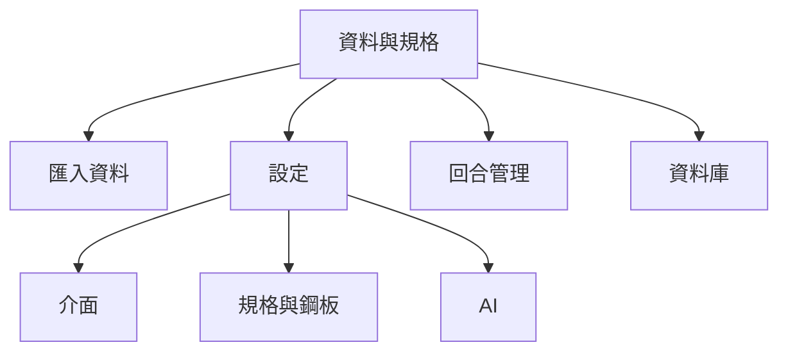

# RFC：介面與設定集中（設定 Hub）

> 區段內容（介面、規格與鋼板、AI）仍以本文件為準。選單位置改由 [設定獨立選單](spec-settings-nav-rfc.md) 規定：「設定」是主頁籤，不再是「資料與規格」的子分頁。

**文件編號**：RFC-SPI-SETTINGS-HUB-20261112  
**版本**：v1.0  
**日期**：2026-11-12  
**狀態**：提議中（Pending Approval）  
**適用版本**：基於 `spi-spc.html` v10.15.6（目標納入後續 minor 版本）  
**參考依據**：

- `AGENTS.md`
- `docs/spec-ui-copy-rfc.md`
- `docs/spec-ui-streamlining-rfc.md`（資料子分頁精簡；本 RFC 覆寫其中「規格與鋼板／AI 設定」子分頁拆法）
- `APPLE_IPHONE_WEB_UI_UX_STANDARD.md`

---

## 1. Problem Statement & Goals

### 1.1 問題陳述（FACT & INFERENCE）

**FACT**

1. `#p-data`（主分頁「資料與規格」）現有 **6 個子分頁**：匯入資料、規格設定、回合管理、鋼板與開孔、資料庫、AI 設定（`data-sub="import|specs|runs|stencil|records|ai-cfg"`）。
2. **製程與規格相關持久設定**分散在「規格設定」與「鋼板與開孔」兩個子分頁；**AI 金鑰／模型／配模型／配額**獨立在「AI 設定」。
3. **主題**切換有 `#btnTheme`（頂欄 `#moreMenu`）與 `#mBtnTheme`（手機 `#moreSheet`），但桌機 CSS 以 `#moreWrap{display:none!important}` 隱藏頂欄「更多」選單，**桌機無穩定可見的主題入口**。
4. **擦拭週期**同時可編輯於規格頁 `#inWipe2` 與進階分析 `#inWipe`；兩者皆綁定 `setWipe()`，易造成「該改哪裡」的認知負擔。
5. 多處跳轉仍指名舊子分頁：如 `#railSpecBtn`、`#btnGateSpec` → `setSub("specs")`；`#btnGoAiCfg` → `setSub("ai-cfg")`；`GOLAB.data` 文案為「看設定」。

**INFERENCE**

- 使用者要找「會影響判定與全站行為」的設定時，需在 3 個子分頁與頂欄／底部選單間來回；與 CHANGELOG「設定目錄整合」敘述相比，**介面偏好（主題）仍落在選單邊角**，未納入同一心理模型。

### 1.2 目標（Goals）

| 目標 | 可驗收指標 |
|---|---|
| 單一「設定」子分頁承載持久／全域設定 | `#p-data` 子分頁由 6 個收斂為 **4 個**：匯入資料、**設定**、回合管理、資料庫 |
| 設定區塊可導覽 | 「設定」內含 **介面**、**規格與鋼板**、**AI** 三區；全站深連結可 `setSub("settings")` 並捲動至區塊錨點 |
| 消除雙軌編輯 | 進階分析頁 `#inWipe` 改唯讀＋連結至 `#inWipe2`；主題控制 **單一 DOM**（刪重複隱藏 `#btnTheme`，手機選單改導向設定區） |
| 桌機主題可達 | 從「設定 → 介面」可切換明亮／深色，不依賴被隱藏的 `#moreWrap` |

### 1.3 非目標（Non-Goals）

- 不搬移 **分析 rail**（回合、量測項目、群組、管制圖、子群組、焊墊、時段篩選）至設定頁；屬當次分析檢視，非持久設定目錄。
- 不搬移各分析分頁的 **圖表／報告暫態選項**（3D 外觀、放大、板號、能力分布、T² 維度、試產比較選回合、報告章節勾選等）。
- 不搬移 **匯入流程**內的格式、欄位對應、機台設定檔（`spi-profiles`）、座標與中繼資料欄位。
- 不變更 `analyze()`、`detectIssues()` 公式與輸出、Cloudflare D1 schema、Worker `/api/*` 契約、`RecDB.create` fail-closed 行為。
- 不實作本 RFC 未列之 `spec-ui-streamlining-rfc.md` 項目（主分頁合併、匯出按鈕刪減、記錄庫三頁籤搬移等）；可平行排程，但本 RFC **只定義設定 Hub 資訊架構與 DOM 歸屬**。
- 本文件階段 **不修改** `spi-spc.html` 與測試；實作為後續 PR。

---

## 2. System Architecture

### 2.1 元件與職責

| 元件 | 職責 |
|---|---|
| `#p-data .subtabs` | 資料主分頁之子分頁列；精簡為 4 鈕 |
| `[data-sub="settings"]` | 設定 Hub 根容器；內含三段 `.card`（非巢狀 card-in-card） |
| `#settingsUiSection` | 介面偏好：主題切換、雙欄狀態唯讀、前往頁首雙欄鈕之說明 |
| `#settingsSpecSection` | 原 `specs`＋`stencil` 卡片串接：規格表、鋼板厚度、刮刀方向、擦拭、階梯鋼板、開孔 |
| `#settingsAiSection` | 原 `#aiSettingsCard` 整塊移入 |
| `setSub(k)` / `setSubSettingsAnchor(anchor)` | 子分頁切換；舊鍵 `specs`／`stencil`／`ai-cfg` 對應至 `settings`＋捲動 |
| `applyTheme` / `toggleTheme` | 不變；主題 UI 僅掛在設定介面段 |
| `#duoToggleBtn` | 雙欄開關唯一快捷控制；設定頁只鏡像狀態 |

### 2.2 目標資訊架構

```text
#p-data（資料與規格）
├─ import     匯入資料
├─ settings   設定（新）
│   ├─ [錨點 ui]      介面
│   ├─ [錨點 spec]    規格與鋼板
│   └─ [錨點 ai]      AI
├─ runs       回合管理
└─ records    資料庫（若日後依 spec-ui-streamlining 併入記錄庫，本子分頁可刪除；AI 仍留於 settings）
```



### 2.3 資料流（持久狀態）

- **主題**：`localStorage spi-theme` ← `applyTheme(mode, save)`；設定頁按鈕為唯一可見寫入入口（實作時移除重複 `#btnTheme` onclick）。
- **鋼板／規格／擦拭／刮刀方向**：仍寫入 `S.*` 與 `persist()` → `localStorage spi-stencil`、回合物件、料號規格版本（既有路徑不變）。
- **AI 設定**：仍用既有 `AI_CFG_KEY` 與 `localStorage`；`initAiPage()` 在 `S.sub==="settings"` 且 AI 區可見時呼叫（等同現行 `ai-cfg` 條件）。

### 2.4 關鍵互動序列

**A. 頂端「鋼板／規格」捷徑**

1. 使用者點 `#railSpecBtn`
2. `setTab("data")` → `setSub("settings")` → `scrollToAnchor("spec")` → focus `#inStencil2`（可選）

**B. 問題閘門「前往規格設定」**

1. `setSub("settings")` + `scrollToAnchor("spec")` + 聚焦 `#btnSpecSave`（若可編輯）

**C. AI 分頁「前往 AI 與配額設定」**

1. `setSub("settings")` + `scrollToAnchor("ai")` + `initAiPage()`

**D. 手機「更多」主題列**

1. 點 `#mBtnTheme`：**關閉** `#moreSheet` → `setTab("data")` → `setSub("settings")` → `scrollToAnchor("ui")`（**不再**就地 `toggleTheme()`）

**E. 進階分析擦拭唯讀**

1. `#inWipe` 顯示 `S.wipe`，`disabled` 或 `readonly`
2. `#btnGoWipeSpec`（新）→ 序列 B 的 spec 錨點，焦點 `#inWipe2`

### 2.5 向後相容：`setSub` 別名

實作期內建對照表（不新增 URL hash 段）：

| 呼叫／舊 `data-sub` | 對應行為 |
|---|---|
| `specs` | `settings` + anchor `spec` |
| `stencil` | `settings` + anchor `spec`（捲至階梯鋼板／開孔卡片） |
| `ai-cfg` | `settings` + anchor `ai` |
| `settings` | 僅切換；預設捲至頂（介面段） |

`S.sub` 運行時字面量統一為 `"settings"`；測試與手冊更新後不再依賴 `ai-cfg` 作為 `S.sub` 值。

---

## 3. Data Model & Interfaces

### 3.1 設定項盤點與歸屬總表

| 類別 | 控制項 / DOM（現況） | 歸屬 | 備註 |
|---|---|---|---|
| **介面** | `#btnTheme` / `#mBtnTheme` | 設定 → 介面 | 合併為設定內單一主題控制；刪 `#btnTheme`；`#mBtnTheme` 改導覽 |
| | `#duoToggleBtn` | 頂欄（不搬） | 設定頁顯示 `S.duo.active` 與說明文字 |
| | `spi-collapsed` | 不納入 Hub | 各頁折疊記憶，非使用者主動「設定」 |
| **規格與製程** | `#inStencil2`, `#selSqDir`, `#inWipe2`, `#specTbl`, `#specGrpTbl`, `btnSpecSave`… | 設定 → 規格與鋼板 | 自 `data-sub="specs"` 移入 |
| | 階梯鋼板 `#chkStep`, `#zoneTbl`, `#zoneMap`… | 同上 | 自 `stencil` 移入 |
| | 開孔 `#apTbl`, `#geomPadFile`… | 同上 | 自 `stencil` 移入 |
| | `#inWipe`（進階分析） | 留在進階分析 | **唯讀** + 連結至 `#inWipe2` |
| **AI** | `#aiSettingsCard` 全區 | 設定 → AI | 自 `ai-cfg` 移入 |
| **分析 rail** | `#selRun`, `#selMetric`, `#selGroup`, `#selChart`, 時段篩選… | 不變 | 分析情境篩選 |
| **匯入** | `#selVendor`, `#mapBox` 內對應選項、`#selProfile`… | 匯入資料 | 單次匯入作業 |
| **資料庫** | `#recCard` 全區 | 資料庫子分頁 或 記錄庫 modal | 與精簡 RFC 資料庫搬移可疊加 |
| **帳號** | 登出、分享 | 頂欄／更多 | 非設定 Hub |

### 3.2 實體與儲存（不變）

| 儲存鍵 / 實體 | 內容 | 變更 |
|---|---|---|
| `spi-theme` | `light` / `dark` | 無 schema 變更 |
| `spi-stencil` | 厚度、高度公差、階梯、開孔、geometryPads | 無 |
| `AI_CFG_KEY`（localStorage） | 金鑰遮罩狀態、模型、配額 | 無 |
| `spi-profiles` | 匯入欄位對應設定檔 | 留在匯入流程 |
| D1 料號規格版本、回合 JSON | 雲端／本機既有 | 無 migration |

### 3.3 API 契約

- **無新增或修改** Worker 端點。
- `GET /api/analyze?models=1&provider=…`、AI 用量統計等維持現行；設定 Hub 僅搬移呼叫 `initAiPage()` 的 DOM 掛載點。
- API 金鑰仍 **不寫入 D1**；僅瀏覽器 `localStorage` + 請求標頭轉發。

### 3.4 路由與 Hash

- 主分頁 hash 仍為 `#data`；**不**引入 `#data/settings/ai` 等深層 hash（除非後續 ADR 另議）。
- 深連結以 `setTab` + `setSub` + `scrollToAnchor` 在 SPA 內完成；書籤仍只記主分頁。

---

## 4. Security, Performance & Rollout

### 4.1 威脅模型

| 風險 | 緩解 |
|---|---|
| 設定頁集中後誤以為 AI 金鑰已上雲 | 維持現有說明文案；金鑰欄位仍 password + 本機儲存提示 |
| 管理者區塊（若日後移入記錄庫）暴露於錯誤分頁 | 權限 `hidden` 邏輯不變，只改容器父節點 |
| XSS 經設定表單 | 不新增 innerHTML 模式；沿用既有 `esc()` 與 `textContent` 守衛（含 Plain Text Integrity Guard） |

### 4.2 效能

- 設定 Hub 為靜態 DOM 搬移；`renderSpecTbl` / `renderZones` / `renderAperture` / `initAiPage` 觸發條件改為 `S.sub==="settings"`（或 anchor 進入 spec／ai 時 lazy，實作可選）。
- 單次進入設定頁不應多於現行分別進入 specs + stencil + ai-cfg 的渲染總成本；避免重複 `initAiPage` 綁定（用 idempotent init）。

### 4.3 推出與回滾

| 項目 | 說明 |
|---|---|
| Feature flag | **無**；一次 UI 重構隨版本發布 |
| Telemetry | 無新增；可選在實作 PR 記錄設定子分頁點擊率（非本 RFC 必須） |
| 回滾 | Git revert PR；`localStorage` 鍵向後相容，舊版可讀新資料 |
| 測試更新 | `tests/ui.smoke.test.js`：6 子分頁 → 4；`ai-cfg` → `settings` + `#settingsAiSection`；擦拭唯讀斷言 |
| 文案 | `#railSpecBtn` title、`goto` 相關提示改為「資料與規格 → 設定」；遵守 `docs/spec-ui-copy-rfc.md` |
| UI 驗收矩陣 | build 產物、1440／820／390／320、明暗主題，確認設定頁三區無橫向溢出、觸控熱區 ≥44px |

### 4.4 與其他 RFC 的關係

| 文件 | 關係 |
|---|---|
| `spec-ui-streamlining-rfc.md` | 其「4 子分頁 = import \| specs(含 stencil) \| runs \| ai-cfg」由 **本 RFC 取代** 為 `import \| settings \| runs \| records`；其餘精簡項目不變 |
| `spec-entry-exit-consolidation-rfc.md` | 匯入／匯出 Hub 與設定 Hub **正交**；不衝突 |
| `spec-ai-provider-governance-rfc.md` | AI 欄位語意不變；只改 DOM 位置 |

---

## 5. 驗收條件（Given / When / Then）

1. **子分頁數量**  
   - Given 使用者進入「資料與規格」  
   - When 檢視子分頁列  
   - Then 僅見「匯入資料」「設定」「回合管理」「資料庫」四項

2. **主題桌機可達**  
   - Given 桌機寬度 ≥1280px  
   - When 開啟「設定 → 介面」並切換主題  
   - Then `document.documentElement[data-theme]` 變更且重新整理後仍一致

3. **規格捷徑**  
   - Given 任一分析分頁  
   - When 點 rail「鋼板／規格」  
   - Then 顯示設定頁規格與鋼板區且 `#inStencil2` 可見

4. **AI 捷徑**  
   - Given「AI 分析」分頁  
   - When 點「前往 AI 與配額設定」  
   - Then 顯示設定頁 AI 區且 `#aiSettingsCard` 可互動

5. **擦拭單一寫入點**  
   - Given「進階分析」卡片  
   - When 嘗試編輯 `#inWipe`  
   - Then 不可編輯；連結可導至 `#inWipe2` 並成功 `setWipe`

6. **統計零回歸**  
   - Given 固定 golden 回合資料  
   - When 僅實作 UI 搬移後執行 `npm test` 與 `npm run test:slow`  
   - Then 數值輸出與改版前一致（`tests/golden.test.mjs` 等）

---

## 6. 實作檢查清單（後續 PR 用）

- [ ] 刪除子分頁鈕 `specs`、`stencil`、`ai-cfg`；新增 `settings`
- [ ] 搬移 DOM 至 `[data-sub="settings"]`；`grid-template-columns: minmax(0,1fr)`；無 `.card .card` 巢狀
- [ ] 實作 `setSubSettingsAnchor` 與 `setSub` 別名表
- [ ] 更新 `renderTabByName` 中 `data` 分支條件
- [ ] 主題 UI 單一化；`#mBtnTheme` 改導覽；移除 `#btnTheme` 或解除 `#moreWrap` 依賴（二擇一以「設定為準」）
- [ ] `#inWipe` 唯讀化與 `#btnGoWipeSpec`
- [ ] 更新 smoke／mobile-layout 相關測試與 `tests/ui-copy.test.mjs` 禁用模式掃描範圍（若文案變更）
- [ ] CHANGELOG 條目於實作版本 bump 時撰寫

---

**核准後下一步**：開 `work/*` 分支實作上述檢查清單，通過 `npm test` 與 UI 驗收矩陣後 PR 合併。
