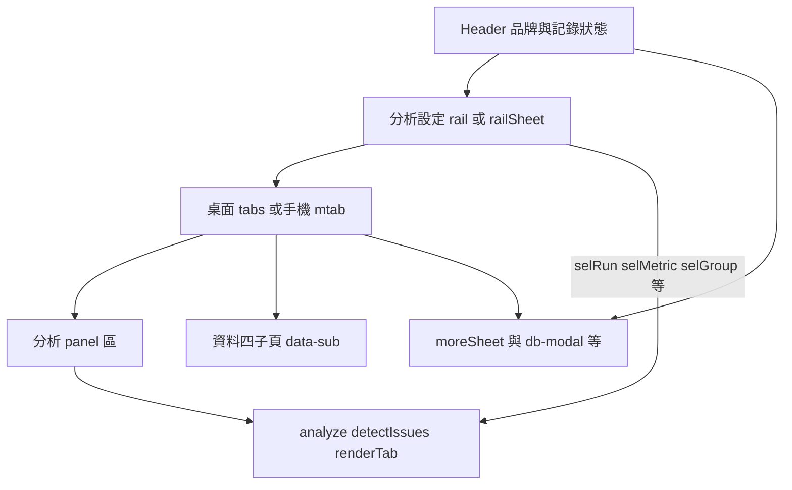

# RFC-SPI-UI-20261029：分析台 UI 系統盤點與版面契約

**文件編號**：RFC-SPI-UI-20261029  
**版本**：v1.0  
**日期**：2026-10-29  
**狀態**：草案 (Draft / For Review)  
**作者**：Cursor Agent（UI/UX 盤點 session）  
**審查對象**：前端維護者、QE／SPC 使用者代表  

**範圍聲明**：本 RFC 僅記錄現況盤點、設計檢索取捨與後續版面工作的驗收契約。**不包含程式實作**；核准本文件不等於核准改版面 PR。

**驗證狀態（本文件交付時）**：瀏覽器 build 產物巡檢、iPhone 真機 — **`NOT TESTED`**（本 session 只產出文件）。

---

## 1. 問題陳述與目標 (Problem Statement & Goals)

### 1.1 背景與問題 (Problem)

SPI·SPC 分析台是單頁、高密度製程分析工具（主殼層在 [`spi-spc.html`](../spi-spc.html)），已具備語意 CSS token、桌面橫向頁籤、手機底欄、分析設定 rail／sheet、多個 `role="dialog"` 模態，以及與 [`AGENTS.md`](../AGENTS.md)、[`APPLE_IPHONE_WEB_UI_UX_STANDARD.md`](../APPLE_IPHONE_WEB_UI_UX_STANDARD.md) 對齊的觸控與 overflow 規則。

問題不在「缺少一套新品牌色」，而在 **視覺與版面決策分散**：

1. **Token 正本與例外並存**：`:root` 已集中 `--bg`、`--accent`、`--ok`／`--warn`／`--ng` 等，但部分區塊仍用行內 `style`、或 `--c-sub` 回退 `#666` 繞過 `--muted`。
2. **圖示策略不一致**：手機底欄（`.mtab-btn`）已用 SVG stroke 圖示；頂欄、範例橫幅、記錄庫模態等仍用 emoji（例如 `📂`、`💡`），與 Institution／ui-ux-pro-max「不以 emoji 當圖示」建議衝突。
3. **雙軌導覽為刻意設計**：桌面 `.tabs`（含 `tabgrp` 作業分組）與手機 `.mtab` + `#moreSheet` 並存；需文件化為**已接受例外**，避免日後「合併 DOM」類 refactor 誤傷焦點與測試。
4. **外部設計檢索易誤導**：以「製程／儀表板」關鍵字查 ui-ux-pro-max `--design-system` 時，常回傳 **Hero + CTA 落地頁** 或 **Enterprise Gateway** 版型與藍色 SaaS 色盤，與現有銅色 accent、Barlow／CJK 字型、Chart.js 技術棧不符；若未寫明取捨，Agent 可能誤做品牌重刷。

### 1.2 目標 (Goals)

1. **凍結現有品牌與 token 正本**：明亮主題為基準；`--accent:#A3521D` 等 solder-mask 中性底 + 銅色強調維持不變，除非產品另行核准。
2. **文件化殼層與導覽契約**：14 個主分析分頁、4 個「資料與規格」子頁、手機「更多」sheet、主要 dialog 清單與功能容器邊界。
3. **記錄 ui-ux-pro-max 查詢結果與採用／拒絕清單**，供後續 PR 對照，且不建立 `design-system/` persist 產物（未授權）。
4. **列出 P1／P2 缺口與後續驗收矩陣**（對齊 `AGENTS.md` 與 `tests/mobile-layout.test.mjs`），作為下一階段 `direct-fix` 的輸入。

### 1.3 非目標 (Non-goals)

- 不改統計公式、偵測門檻、`buildRows`／欄位語意、Cloudflare D1／R2 API、登入授權。
- 不引入 React／Tailwind／新 UI framework；不把單檔 SPA 拆框架。
- 不重排資訊架構（頁籤順序、作業分組標籤維持現行「找問題 → 看證據 → 改善與驗證 → 設定」）。
- **本 RFC 不實作任何 CSS／HTML 變更**；不遞增 `package.json` version。
- 不把 [`vendor/login-auth.js`](../vendor/login-auth.js) 登入頁納入本次視覺重設計範圍（僅引用 Institution 版本字串規則，見 §4.3）。

---

## 2. 系統架構與資料流 (System Architecture & Data Flow)

### 2.1 殼層組件（Presentation Shell）

分析 UI 與統計核心同處一頁；**殼層只負責導覽、篩選參數呈現、圖表／表格容器與對話框**，不重新解釋量測欄位。

**不變量**：使用者在 rail／sheet 變更試產回合、量測項目、群組、管制圖類型等，僅影響**呈現與篩選**；不得透過 UI 改版改寫匯入契約或雲端寫入語意（見 `AGENTS.md` RecDB fail-closed）。

### 2.2 主分頁與子頁清單

| 分組（桌面 `tabgrp`） | `data-tab` | Panel ID | 說明 |
|----------------------|------------|----------|------|
| 找問題 | `issues` | `#p-issues` | 問題偵測（預設） |
| 找問題 | `overview` | `#p-overview` | 總覽 |
| 看證據 | `control` | `#p-control` | 管制圖 |
| 看證據 | `capability` | `#p-capability` | 製程能力 |
| 看證據 | `sim3d` | `#p-sim3d` | 3D 錫膏模擬 |
| 看證據 | `cross` | `#p-cross` | 交叉驗證 |
| 看證據 | `adv` | `#p-adv` | 進階分析 |
| 看證據 | `stats` | `#p-stats` | 統計資料 |
| 改善與驗證 | `compare` | `#p-compare` | 試產比較 |
| 改善與驗證 | `dfm` | `#p-dfm` | DFM 建議 |
| 改善與驗證 | `lab` | `#p-lab` | 實驗驗證 |
| 改善與驗證 | `ai` | `#p-ai` | AI 分析 |
| 改善與驗證 | `report` | `#p-report` | 分析報告 |
| 設定 | `data` | `#p-data` | 資料與規格（含子頁） |

**「資料與規格」子頁**（`#p-data` 內 `data-sub`）：`import`（匯入與規格）、`runs`（回合管理）、`stencil`（鋼板與開孔）、`records`（資料庫）。

**手機底欄（≤5 項）**：問題、總覽、管制圖、能力、**更多**（`#moreSheet` 含其餘分頁與記錄庫／主題／帳號工具）。

**輔助 panel**（非主 tab 列項目，由流程進入）：`#p-gate`、`#p-share`、`#p-shares`、`#p-mail` 等 — 改版面時須一併納入驗收矩陣，不可視為「次要而略過」。

### 2.2.1 導覽 DOM 雙軌（已接受例外）

| 視口 | 導覽 DOM | 備註 |
|------|----------|------|
| 桌面／寬螢幕 | `.tabs-bar` + `.tab` + `tabgrp` | 可橫向捲動、`tabScrollL/R` |
| 手機 | `.mtab` + `#moreSheet` | 底欄 SVG + sheet 列表 |

Institution Web 規則偏好「同一語意單 DOM + CSS 斷點」；本產品因歷史與測試 hook（`window.SPI_TEST_HOOK`、mobile-layout 測試）維持雙軌。**後續優化應優先 CSS 與 ARIA 一致，而非在未驗證前強制合併節點。**

### 2.3 功能容器（不可當裝飾層移除）

下列容器具 scroll host、focus trap、portal 或 sticky 行為，屬 **functional**（configure-web-layout-theme 契約）：

- `.sticky` 區：rail + tabs + `#toc` + `#ctxBar`
- `#railSheet`、 `#moreSheet`（`.sheet-modal`）
- `#recPickerModal`、`#specSaveModal`、`#specVerModal`、`#proofModal`、`#unmatchedRefsModal`、`#recEditModal` 等 `.db-modal`
- 圖表 `.chartbox`、表格水平捲動區、LISA／3D canvas 固定 CSS 尺寸區
- `.report-preview` 列印白紙（深色主題下須重宣告明亮 token — 已有專案測試 8d／8e）

**裝飾性 card-in-card**：禁止為「整頁再包一層 card」；既有 `.card` 用於重複資料單元（問題卡、KPI、工具區）時保留。

---

## 3. 設計 Token、外部檢索與介面缺口 (Design Tokens & Gaps)

### 3.1 現行 CSS Token 正本（保留）

定義於 [`spi-spc.html`](../spi-spc.html) `:root`（摘要）：

| 語意 | 變數 | 明亮（約） |
|------|------|------------|
| 背景 | `--bg` | `#F2F4F0` |
| 表面 | `--surface` / `--surface2` | `#FFFFFF` / `#E8ECE6` |
| 文字 | `--ink` / `--muted` | `#18201B` / `#58625B` |
| 主色／CTA | `--accent` / `--accent-soft` / `--accent-ink` | `#A3521D` 系 |
| 狀態 | `--ok` / `--warn` / `--ng` + `*-soft` | 綠／琥珀／紅 |
| 圖表輔色 | `--series2` | `#3D6E8F` |
| 字型 | `--f-display` / `--f-body` / `--f-mono` | Barlow Condensed + CJK；IBM Plex Mono |
| 觸控／安全區 | `--tap-min:44px`；`--safe-*` | 對齊 IOS-04 工程目標 |
| 圓角 | `--r` / `--r-card` / `--r-sheet` | 10 / 16 / 20 px |

深色：`@media (prefers-color-scheme: dark)` 與 `[data-theme="dark"]` 覆寫；使用者可經「更多／sheet」切換（`#btnTheme` / `#mBtnTheme`）。**明亮仍為產品基準**（Institution §3）。

Viewport：`<meta name="viewport" content="width=device-width, initial-scale=1, viewport-fit=cover">` — 符合 IOS-01／IOS-02 基礎。

### 3.2 ui-ux-pro-max 查詢紀錄（未 persist）

查詢工具：`ui-ux-pro-max/scripts/search.py`（`python -B`，**未**使用 `--persist`）。

| 查詢 | Dials | 回傳 Pattern（摘要） | 回傳色／字型（摘要） |
|------|-------|----------------------|----------------------|
| `manufacturing quality SPC dashboard` | density 8, variance 3, motion 2 | Hero + Features + CTA | Primary `#2563EB`；Fira Sans／Fira Code；GSAP scroll reveal |
| `internal analytics dashboard`（重試） | density 9, variance 2, motion 1 | Enterprise Gateway | Primary `#1E40AF`；同上字型／動效 |

**採用的檢索約束（一般性 UX，非色值）**

- 瑞士／極簡：**清晰網格、高對比、資料優先、低密度裝飾**（對本產品解讀為「儀表密度高但視覺噪音低」）。
- 明亮 + 可選深色；正文對比 ≥ 4.5:1；可見 focus；`prefers-reduced-motion`（現程式已有 `.spin` 降速等片段）。
- 圖示：SVG，不用 emoji 充當 icon。
- 圖表（`--domain chart`，`control chart legend tooltip`）：異常點須 **形狀／文字／列表** 冗餘，不可只靠顏色；KPI 須有可讀數字與目標文字（與 `--warn`／`--ng` pill 並存）。

**明確不採用**

- 藍色 SaaS 重刷（`#2563EB`／`#1E40AF` 等）取代 `--accent`。
- Fira 字型與 Google Fonts CDN（現行 vendor woff2 + 系統 CJK）。
- Hero／CTA、Enterprise Gateway 區塊、scroll reveal 動效。
- 圖表棧改 D3／Plotly／ApexCharts（維持 Chart.js UMD）。
- `--stack html-tailwind`（本 repo 非 Tailwind 專案；技術棧為 inline CSS 單檔 SPA）。

### 3.3 外部角色 → 現有 token 對照（供 Agent 對齊用）

| 檢索／Institution 角色 | 本專案變數 |
|------------------------|------------|
| Primary / CTA | `--accent`（按鈕 `.primary`） |
| Background | `--bg` |
| Card / Surface | `--surface`、`--surface2` |
| Foreground | `--ink` |
| Muted text | `--muted` |
| Border | `--line`、`--c-hairline` |
| Destructive | `--ng`（`.danger` 等） |
| Success / Warning | `--ok` / `--warn` |
| Focus ring | 依元件 CSS（改版時須全站一致，禁止 `outline:none` 無替代） |

### 3.4 缺口清單（後續 PR 輸入）

| ID | 優先級 | 描述 | 狀態 |
|----|--------|------|------|
| UI-GAP-01 | P1 | Emoji 作圖示（記錄庫、範例提示） | **已出貨** v10.9.1 |
| UI-GAP-02 | P1 | 行內 `style` 與 `--c-sub:#666` | **部分** v10.9.2：主要 `.db-modal`／`#libWarn`；全站行內 style 仍多（非阻斷） |
| UI-GAP-03 | P1 | 320px 整頁橫向溢出 | **自動化通過**（`mobile-layout` 測 8）；iPhone 真機 NOT TESTED |
| UI-GAP-04 | P1 | 觸控 44px 同權重順序 | **自動化通過**（測 5／7） |
| UI-GAP-05 | P2 | `font-weight:600` 與 CJK | **刻意保留** Barlow 600／部分 UI 600；全站改 700 另開 PR |
| UI-GAP-06 | P2 | 對話框按鈕順序 | **部分** v10.9.2：`#recEditModal` 已修正；`specSave`／`specConfirm`／撤銷列原本符合 |
| UI-GAP-07 | P2 | 容器扁平化 | **不適用**（無新溢出案例；`#p-adv` 已禁 card-in-card） |

---

## 4. 安全、效能、驗收與上線 (Security, Performance & Rollout)

### 4.1 威脅與邊界（UI 視角）

- UI 改版不得削弱登入後路徑的 CSRF／session 假設；不新增 inline script 注入面。
- 分享／AI 設定等 dialog 仍須 **focus trap + Esc** 與可見標籤；不得以 Toast 取代需確認的破壞性操作（Institution Web §9）。

### 4.2 效能（UI 視角）

- 維持 AGENTS 規則：自繪 canvas 須固定 CSS width／height，避免 dpr 累乘（LISA 案例）。
- 不在殼層引入 scroll-linked 動畫或大型 GSAP；Boot 期 `#bootHide` 為 CLS 緩解，改版時保留同等策略或量測替代方案。

### 4.3 版本字串（登入頁／殼層）

Institution §9：版本單一來源 `package.json`；build 注入 `#appVer`／`#appBuilt`（Asia/Taipei）。分析台 header 與 `#moreSheet` 內版本顯示須與 build 產物一致 — **後續 UI PR 若觸及版本 DOM，須跑 release-check／build 驗證**。

### 4.4 後續版面 PR 驗收矩陣（必跑）

以 **`npm run build:cloudflare` 產物**（非 dev server）為準：

| 維度 | 條件 |
|------|------|
| 寬度 | 1440、820、390、320 CSS px |
| 主題 | 明亮 + 深色（含 `.report-preview` 列印對比） |
| 路由／分頁 | 14 主分頁 + 4 資料子頁 + 「更多」sheet + 設定／帳號選單 + 主要 dialog |
| 溢出 | 320px 下 `document.documentElement.scrollWidth === clientWidth`（表格／圖表允許**區域** scroll） |
| 觸控 | 可點目標 ≥ 44px（含 label 包住 checkbox） |
| dpr | devicePixelRatio > 1 下同一頁進出 ≥ 2 次（canvas 寬度不累乘） |
| 自動化 | `npm test`（含 `tests/mobile-layout.test.mjs`）；UI 邏輯變更前先跑 `tests/ui.smoke.test.js` |
| 真機 | iPhone Safari — 未測須標 **`NOT TESTED`** |

狀態色（OK／NG／Warning）須保留文字或 pill，符合 IOS-13／Institution §5。

### 4.5 Rollout

- 建議後續工作拆小 PR：P1 缺口（emoji、token 收斂、overflow）與 P2（字重、dialog 順序盤點）分開，每 PR 附驗收矩陣結果表。
- 合併到 `main` 仍依 `AGENTS.md` 部署驗證（須走登入後資料庫路徑或 API 200）。

---

## 5. 相關文件

- [`AGENTS.md`](../AGENTS.md) — 版面 grid／overflow、canvas、驗收矩陣、build 守衛
- [`APPLE_IPHONE_WEB_UI_UX_STANDARD.md`](../APPLE_IPHONE_WEB_UI_UX_STANDARD.md) — IOS-01～IOS-18
- Institution `06-ui-ux-universal.md` — 跨專案 UI 真本
- [`tests/mobile-layout.test.mjs`](../tests/mobile-layout.test.mjs) — 自動化版面回歸

---

## 6. 修訂紀錄

| 版本 | 日期 | 說明 |
|------|------|------|
| v1.0 | 2026-10-29 | 初版：UI 盤點 RFC；無程式變更 |
| v1.1 | 2026-10-29 | 對照 v10.9.1 程式：UI-GAP-01／02 部分 |
| v1.2 | 2026-10-29 | §3.4 狀態欄、§7 本輪收斂 |
| v1.3 | 2026-10-29 | v10.9.2 程式收斂；§7 計畫完成度 |

---

## 7. 本輪收斂（2026-10-29）

| 項目 | 結果 |
|------|------|
| 計畫範圍 | RFC 文件 + RFC §3.4 P1 實作 + §4.4 自動化驗收矩陣（**不含** design-system persist、登入頁重設計、全站 inline 清零） |
| 已合併 `main` | `4e712f1` RFC；`606f247` v10.9.1；`3c99798` RFC v1.2；`b0502cd` **v10.9.2** 模態 token／`#recEditModal` 按鈕順序（同 commit 含 **v10.9.3** AI 429 修復） |
| 自動化 | `ui.smoke`、`mobile-layout`（含 emoji／`recEditSave` 守衛）、`npm test` 398／398；`release-check` **NEEDS REVIEW**（console 2 處，exit 0）；`build:cloudflare` 2026-10-29 14:03 UTC+8 |
| 真機 | iPhone Safari — **NOT TESTED**（計畫 §4 允許） |
| 正式站靜態 | 登入頁 `https://spi-spc-analyst.chihfu-chen-tw.workers.dev/login` HTTP 200，顯示 **v10.9.3**（2026-10-29 13:51 UTC+8）；**登入後資料庫路徑未驗證** |
| 殘留 | 大量 panel 行內 `style`（AI 設定卡等）；`font-weight:600` 全站未改 |

**計畫明確不做（已遵守）：** 無 `design-system/` persist、無 Tailwind／品牌重刷、未改 `tests/mobile-layout` 斷點矩陣邏輯（僅增 emoji 守衛）。
